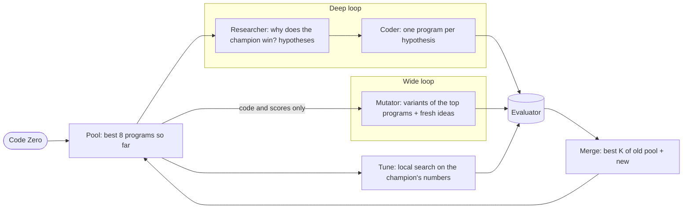
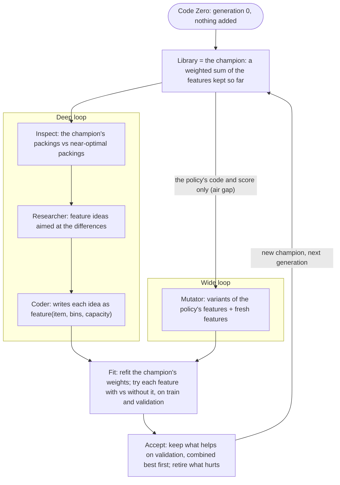

# Helix: handoff

Written on October 12, 2026, when the project changed hands. It covers what Helix is, how the repo is laid out, how to run it, what every run so far showed, what we learned, the mistakes made along the way, the rules the owners work by, and what is still unknown. Luminal (the model provider) has its own guide: [LUMINAL.md](LUMINAL.md).

**Status in one paragraph.** Helix is a two-loop evolutionary search in which LLM agents improve a deliberately bad program (Code Zero) for online 2D vector bin packing. The first engine (agents write whole programs) reached at best 27% of the way from Code Zero to the optimal packing (run 2). A second engine (agents write *features*, an optimiser sets the numbers, validation instances decide what's kept) was built on October 12. Its first real run started from a hand-written head start by mistake, so it isn't comparable with the earlier runs. That head start was removed, and run 5 (10 generations from Code Zero) reached 25.1% on train and 25.6% on the held-out test split. **The next step is to compare the two engines properly from the same start (longer runs, repeats), starting with run 5 against run 2.** Every run's full trace is in `results/`.

---

## 1. Where this came from

Helix was built at a hackathon on October 11, 2026, for the track *"Build a Self-Improving Agent Team"* set by Luminal (YC S25). The brief:

- build a system where several AI agents work in parallel to improve a solution through repeated rounds of proposing, testing and learning;
- pick a problem with a measurable outcome; use DeepSeek or GLM Flash models hosted on Luminal Cloud;
- show a working demo, the starting baseline, and how performance improves over successive rounds; evaluate the final solution on fresh tests not used during optimisation;
- judged on relative improvement and problem difficulty.

That brief is why some rules below are strict: the starting point (Code Zero) has to be the true baseline, every gain has to come from the system, and the final check has to use instances the search never saw.

**People.**
- **Shreyas Naik** (GitHub `cybercryptixcoder`) owns `helix/` (the search loop, dashboard, tools) and `CONTRACT.md`.
- **Sai Vikram** (GitHub `KRSaivikram1` / `saivikramkr1000`) owns `evaluator/`, `programs/`, `demo/` and `RUN_REVIEW.md`.

Most of the code in `helix/` was written with an AI coding assistant working for Shreyas.

**The original concept** (Shreyas's flowchart from the start of the project):

- **One shared evaluator.** The problem lives there; it scores every program as a black box.
- **Deep loop:** a *Researcher* LLM reads ranked scores and works out *why* programs did well or badly, then forms hypotheses. A *Coder* LLM writes one program per hypothesis, changing a single variable ("Wordle-style: change one letter"). The programs are scored by the evaluator.
- **Wide loop:** a *Mutator* LLM takes the top programs and generates variants with no research direction, on purpose, to keep diversity.
- **The air gap:** the Mutator only ever sees programs and their scores, never the hypotheses or the research direction. This is what keeps the wide loop wide.
- **Code Zero** seeds both loops.

Both engines keep that concept. The feature engine changes *what* the agents write, not the two-loop structure.

**The goal after the hackathon** (Shreyas's words, paraphrased): make Helix a robust and genuinely interesting system; compare each new setup with the previous runs, and see the improvement show up as the algorithm getting better *faster* from the same starting point. Every change since has been judged by that.

---

## 2. Quick start

```bash
git clone https://github.com/cybercryptixcoder/helix_evolve && cd helix_evolve
pip install -r helix/requirements.txt          # numpy, cma, certifi, matplotlib, pymongo
python -m helix.ui                              # dashboard at http://127.0.0.1:8765
```

In the dashboard: **Connect** (paste the Luminal key, **Save**, **Test model**), then **New run**. The feature engine is the default; 30 generations matches run 2. Tick *Offline test* to run the whole pipeline with a fake model and no key.

From the command line:

```bash
python -m helix.run --generations 30                       # feature engine (default)
python -m helix.run --engine programs --generations 30     # program engine (runs 1-3)
python -m helix.run --fake-llm --generations 2             # offline test
python -m helix.run --resume helix/runs/<run> --generations 40
python -m helix.analyze helix/runs/<run>                   # diagnostics, plain text
python -m helix.report helix/runs/<run>                    # held-out check on the test split
```

To hand a run to someone for analysis:

```bash
RUN=$(ls -t helix/runs | head -1)
python -m helix.analyze helix/runs/$RUN > helix/runs/$RUN/analysis.txt 2>&1
zip -qr ${RUN}_export.zip helix/runs/$RUN
```

`helix/README.md` has every command and option.

---

## 3. The problem

**Online 2D vector bin packing.** Jobs arrive one at a time, each needing some CPU and some memory. Every bin (a machine) has the same capacity in both. Each job must be placed at once and for good, in an open bin with room in both resources or in a new bin. Jobs never leave. Use as few bins as possible.

A candidate is one Python function, `priority(item, bins, capacity)`, that scores the bins the job fits in. The last row is always a new empty bin. The simulator puts the job in the highest-scoring bin; on a tie, the oldest bin wins. Only `numpy` and `math` may be imported, and no state may be kept between calls. `CONTRACT.md` has the full rules and the reference simulator.

**Code Zero** (`programs/code_zero.py`) returns all zeros, so the oldest bin that fits always wins: First Fit. It's deliberately weak, and it's the baseline every run starts from.

**Instances** (`evaluator/problem.py`):
- `train`: 6 families × 3 instances × 1,000 jobs, capacity [100, 100], seed 1.
  - `uniform`: CPU and memory independent, 1-50.
  - `correlated`: memory follows CPU.
  - `anticorr`: half CPU-heavy, half memory-heavy.
  - `small`: 1-20.
  - `large`: 15-60.
  - `bimodal`: each resource small or large.
- `test`: the same 6 families with seed 2, plus two the search never sees: `lognormal` (heavy-tailed) and `wide` (capacity [100, 200]). Used only by the final held-out check.
- `quick`: 1 small instance per family, used to reject broken programs in under a second.
- **Validation** (feature engine only, `helix/fit.py`): 4 instances per training family, made by the evaluator's own generator with seed 1001, which no split uses. Used to decide which features are kept.

**Score** (the evaluator's unit): for each instance, excess = bins ÷ lower bound − 1, where the lower bound is total demand in the tighter resource ÷ capacity, rounded up. The score is −(mean over families of the mean excess, in %). Higher is better. Code Zero scores **−9.181** on train. This is the score every run is ranked on, so runs stay comparable.

**Ownership rule:** `evaluator/` and `programs/` belong to Sai Vikram. Don't modify them; others push to this repo too.

---

## 4. Units: how good is a program?

The score's lower bound ignores job shapes, so even a perfect packing can't reach 0, and −6.8 says little on its own. So Helix adds two units measured against the **optimal packing** (`helix/metrics.py`):

- **Waste vs optimal:** extra bins per 100 the optimal packing needs, averaged over families. 0 = optimal.
- **Progress to optimal:** 0% = Code Zero, 100% = the optimal packing.

**The optimum** (`helix/bounds.py`, stored in `helix/bounds.json`) comes from a configuration-LP bound (Gilmore-Gomory), computed by column generation with 2D-knapsack pricing, for every train and test instance.
- **lower:** a proven bound; no packing can use fewer bins.
- **upper:** a real packing, found by diving on the LP solution.
- "Optimal" in the units means the lower bound, so a program is never flattered.
- The optimum's score is −0.449 on train and −0.281 on test. Its excess is only above 0 on `anticorr` (2.43% on train) and `large` (0.27%).
- `helix/optimal_packings.json` holds the near-optimal packings of one train instance per family, which the feature engine's Researcher compares against.
- Recompute with `pip install highspy` and `python -m helix.bounds --compute` (or `--packings`); it takes minutes per instance. This is only needed if the instances change; fingerprints are checked, so stale bounds are never used.

**Yardsticks** on train, in all three units:

| Program | Score | Waste | Progress |
|---|---|---|---|
| Code Zero (first fit) | −9.181 | 8.66 | 0% |
| Best Fit (L1) | −8.775 | 8.25 | 4.7% |
| Norm-based greedy (L2) | −8.662 | 8.14 | 5.9% |
| Best Fit with balance | −8.553 | 8.03 | 7.2% |
| Best Fit (L-infinity) | −8.534 | 8.02 | 7.4% |
| Dot product (Tetris-style), the best classic heuristic | −8.402 | 7.88 | 8.9% |
| `programs/tuned_params.py` (Sai Vikram's hand-tuned baseline) | −8.009 | 7.50 | 13.4% |
| `programs/alphaevolve_borg.py` (AlphaEvolve's Borg heuristic, a reference) | −12.652 | 12.13 | −40% (worse than Code Zero) |
| Offline best-fit decreasing (sees every job in advance; not online) | −5.634 | 5.13 | 40.8% |
| Optimal packing (lower bound) | −0.449 | 0 | 100% |

The classic heuristics are in `helix/references/` (Panigrahy et al. 2011, *Heuristics for vector bin packing*; Grandl et al. 2014, *Tetris*). They're only shown on the dashboard; no agent sees them.

We found no published result for this exact benchmark, so "best in the world" isn't known. The offline packer and the optimum are the useful ceilings.

---

## 5. The repo

| Path | Owner | What it is |
|---|---|---|
| `CONTRACT.md` | Shreyas | The agreement between problem, evaluator and loop: the `priority()` interface, simulator rules, evaluator CLI and output format |
| `evaluator/` | Sai Vikram | Instances, simulator, sandboxed scoring. `python -m evaluator --program P --split train --out R.json`. Its README has baseline results |
| `programs/` | Sai Vikram | Code Zero and hand-written baselines (`best_fit`, `dot_product`, `tuned_params`, `alphaevolve_borg`) |
| `demo/` | Sai Vikram | Hackathon demo slides (`index.html`) and `update_data.py`, which writes a run's numbers into them |
| `RUN_REVIEW.md` | Sai Vikram | Review 2: run 2 while it was running (review 1, of the 18:11 run, is in this file's git history). Its recommendations became v1's knock-outs, pool memory, code-first Mutator, variant slots and the tune branch |
| `helix/` | Shreyas | Everything else: below |
| `HANDOFF.md`, `LUMINAL.md` | Shreyas | These two documents |

Inside `helix/`:

| File | Purpose |
|---|---|
| `run.py` | Entry point (`python -m helix.run`); the program engine (`Search`); live status, stop, resume, publishing |
| `evolve.py` | The feature engine (`FeatureSearch`, a subclass of `Search`) |
| `features.py` | Feature checking (AST: only numpy and math), renaming, composing a policy into a normal `priority()` program |
| `fit.py` | Parallel scoring (worker processes running the evaluator's simulator with its restricted builtins), CMA-ES, one-weight line search, validation, importance |
| `instruments.py` | The packing comparison the feature engine's Researcher reads |
| `roles.py` | Builds every agent message and parses every reply; enforces the air gap |
| `prompts/` | System prompts. `feature_*.md` for the feature engine; `mutator`, `researcher`, `coder`, `zeroshot`, `problem` for the program engine |
| `llm.py` | Model client: Luminal or a local server, streaming, retries, adaptive concurrency, call log, offline `FakeLLM` |
| `diagnose.py` | Sends the real Mutator prompt four ways to check the model |
| `tune.py` | Program engine: finds a program's numeric constants and runs a local search on them |
| `population.py` | `Program`, `Hypothesis`, the run folder store |
| `sandbox.py` | Runs the evaluator CLI on a candidate in its own process, with a timeout |
| `bounds.py`, `bounds.json`, `optimal_packings.json` | The optimal-packing bounds and near-optimal packings |
| `metrics.py` | The readable units and the yardsticks |
| `reference.py`, `references/` | The offline packer, and the classic heuristics |
| `ui.py`, `dashboard.html` | Local dashboard: settings, run controls, live flowchart, per-step details, progress chart with comparisons |
| `analyze.py` | Text diagnostics of a run |
| `peek.py` | Text snapshot of a run's live state |
| `report.py` | Held-out check on the test split, `report.md`, charts |
| `publish.py` | Copies a run's trace into `results/<run>/`, optionally commits and pushes it |
| `mongo.py` | Optional MongoDB mirror of every record |
| `luminal.env` | Committed endpoint and model, **no key** |
| `.env.example` | Template for `helix/.env` (gitignored; holds the key) |

**Run folders** (`helix/runs/<time>-<mode>/`, gitignored):
- `llm_calls.jsonl`: every prompt, reply, hidden reasoning, tokens, seconds and finish reason;
- `programs.jsonl`, `hypotheses.jsonl`, `generations.jsonl`;
- `features.jsonl` (feature engine);
- `status.json` (live state for the dashboard), `config.json`, `candidates/*.py`, `best_program.py`, `console.log`.

Real runs also keep `results/<run>/` up to date (a copy for publishing, with the call log also compressed as `llm_calls.jsonl.gz`). The dashboard's **Publish** button only copies; nothing is committed until someone runs `git add results` and pushes (or `python -m helix.publish helix/runs/<run> --push`). **Runs 2-5 are in `results/` in full**: every agent call with its prompt, reply and hidden reasoning, every program, generation, hypothesis and feature, the console log, and the held-out report.

---

## 6. The program engine (version 1, runs 1-3)

Agents write whole `priority()` programs, numbers included. `python -m helix.run --engine programs`.



One generation, branches in parallel:
1. **Pool:** the best `--pool-size` 8 programs so far, at most `--max-siblings` 3 children of one parent (μ+λ selection). Before Sai Vikram's review 2 the pool forgot everything but the single best; fixed in `a616bb1`.
2. **Deep:** the Researcher studies the champion: what changed from its parent, knock-out results (inherited from ancestors for shared parts), the room left per family, the research log. It proposes **cause** tests (knock out one part; only on a champion that jumped by `--jump` 0.15, only on its new parts) and **improve** tests (one new mechanism). The Coder writes each one. Improve tests have their new numbers tuned before they're judged (**tune-then-judge**, `--judge-tune-evals` 16). Verdicts use `--epsilon` 0.05. After `--stall` 3 generations without progress, the Researcher is told small edits are exhausted, and the Mutator gets an extra fresh slot.
3. **Wide:** from only the top `--top-x` 4 programs' code and scores, the Mutator writes `--variants` 6 programs, `--fresh` 2 of them fresh ideas, code first.
4. **Tune:** local search over the numeric constants of the champion and the best untuned newcomer (`--tune-evals` 48, `--tune-targets` 2, `--tune-seconds` 40, kept if they gain `--tune-margin` 0.05).
5. **Merge** into the next pool.

Also:
- every candidate is checked on `quick` before `train`;
- a failed program gets one repair attempt with its error;
- duplicates (same code hash) are skipped;
- generation 0 is Code Zero plus one wide batch.

Controls: `--mode wide-only | deep-only | zero-shot --n 40` (best of N plain answers, no search).

---

## 7. The feature engine (version 2, the default since October 12)

**Why it exists.** Runs 2 and 3 showed the agents doing two jobs badly at once: inventing mechanisms *and* choosing numbers, judged by scores alone.
- In run 2, 75 of 78 improve tests were "flat" (with `--epsilon` 0.4, too coarse, see §10). Most were a single coefficient moved by about ×1.2: coordinate search done by an LLM.
- The Mutator kept a median 24% of its parent's lines: it rewrote programs rather than varying them.
- Offline experiments without any LLM (§9) showed an optimiser setting the weights of hand-written measurements reaching 35%. Adding ten structural measurements, aimed at what optimal packings do differently, reached 40%.

So the work was split: agents propose *what to measure*, an optimiser sets *how much it counts*, and agents get to see *how* the policy loses, not only by how much.



**A feature** is `feature(item, bins, capacity)` returning one number per candidate bin (or several columns). The policy is `priority = Σ weight × scale × feature`. It's written out (`features.compose`) as an ordinary `priority()` program, and the unchanged evaluator scores every champion, so both engines are ranked on the same score. Ties are protected: totals are rounded to 9 decimals, so floating-point noise never breaks the "oldest bin wins" rule.

**One generation:**
1. **Library:** the current champion's features and weights.
2. **Inspect** (`--inspect`, on by default): for one train instance per family, the champion's packing next to a near-optimal packing of the same jobs. The Researcher sees:
   - jobs per bin;
   - the most common bin make-ups by job size class (S under 20% of a bin, M 20-40%, L 40% or more, per resource);
   - bins stranded with one resource full;
   - room left per bin.
3. **Deep:** the Researcher reads that, the room per family, each feature's weight and importance, and the research log, then proposes `--hypotheses` 4 feature ideas, each naming the number in the comparison that should move. Coders write them in parallel.
4. **Wide**, at the same time: the Mutator sees only the composed policy's code and its score. It writes `--variants` 4 features, `--fresh` 1 of them new and the rest variants of named features.
5. **Fit:**
   - First the champion's own weights are refitted (`--champion-refit-evals` 24); any gain is credited to fitting.
   - Each candidate is checked: it compiles, imports only numpy and math, returns finite values of the right shape, and is at most about 3× slower. If not, its author gets one repair.
   - Then each candidate is tried. Its own weights are searched with the rest fixed (`--trial-evals` 24: a line search for one value, CMA-ES for several). Then all the weights are refitted twice from there, with the same budget (`--trial-refit-evals` 24), step size and random seed: once with the feature and once with it switched off. **The feature is credited only with the difference**, on train and on validation.
6. **Accept:**
   - Features whose validation gain beats `--accept-margin` 0.03 (with any train gain) are combined greedily, best first. Each joins only if validation improves again with it; the others are marked *redundant* (helped alone, but repeat what's kept).
   - Then all the weights are refitted together (`--refit-evals` 64), kept only if train and validation both improve.
   - Features whose removal would score better on validation are **retired**. So are the weakest, if the policy goes over `--max-columns` 60 weights.
   - Importance (validation score lost when a value's weight is zeroed) is recomputed when the library changes, and every third generation.
7. The new champion is scored by the evaluator and recorded. Every candidate is also recorded as a *trial* program: the champion plus that feature, refitted. Trials are never "the best".

**Generation 0 is Code Zero and nothing else.** The library starts empty. An empty policy scores every bin 0, which is First Fit, which is Code Zero; the run checks the two score identically and stops if not.

**What the agents see, compared with runs 2 and 3:**
- **Same as before:** the problem statement; each family's room to the optimum (run 3 had this; run 2 didn't); progress in %; the research log.
- **New:** the packing comparison, Researcher only. Turn it off with `--no-inspect` (or the New run checkbox) for a strictly like-for-like comparison.
- **Never:** no agent sees hand-written measurements, reference programs or solution hints.

**Speed:** the fitter runs on `--fit-workers` (all cores but one). On Shreyas's Mac a training evaluation took about 0.2 s of wall time with 7 workers. A generation was about 70 s with the old, cheaper feature test; the paired test costs about 3× more evaluations per feature, and its timing on that Mac hasn't been measured yet. Agent calls take 2-10 s each (see LUMINAL.md).

---

## 8. Runs so far

| Run | Folder | Engine and code | Gens | Time | Best (train) | Progress | Held-out test | What happened |
|---|---|---|---|---|---|---|---|---|
| 1 | `20261011-180533-full`, `20261011-181101-full` (and short test runs before them) | programs, first version | 2-3 | minutes | −9.034, then −7.455 | | | Hidden thinking: most Mutator calls ran out of tokens with no answer. In the 18:11 run one Mutator program jumped from −8.378 to −7.455, and the deep loop never built on it (review 1) |
| 2 | `20261011-185558-full` | programs, `08784f8` (no pool memory yet; `--epsilon` 0.4) | 30 | 46 min | **−6.793** | **27.4%** | −6.755 (25.0%) | The reference run. Most of the gain by generation 13 (−6.855); one small gain at 29 |
| 3 | `20261012-080715-full` | programs, `eb71b70` (all v1 fixes, tune, tune-then-judge, `--epsilon` 0.05) | 17 (stopped) | 38 min | −7.511 | 19.1% | | Worse than run 2. Stagnated at generation 7. 100 of 108 Mutator calls cut off by hidden thinking; deep produced nothing in 9 of 17 generations. Technical failure, not a verdict on the design |
| 4 | `20261012-124038-full` | features, `62cf672`, **with the hand-written head start** | 10 | 15 min | −6.185 | 34.3% (started at 32.8%) | −5.97 | **Not comparable** (§10). The agents added 1.5 points in 10 generations |
| 5 | `20261012-134507-full` | features, `234f4e8`, from Code Zero, packing comparison on | 10 | 47 min | −6.986 | 25.1% | −6.703 (25.6%) | The first clean feature-engine run. 99 LLM calls. Not analysed yet |

Details:
- **Run 2:**
  - Gains came from wide early (generations 0-2: −9.18 → −7.55), then alternated between deep and wide.
  - Calls: 423 in all; 100 of 186 Mutator calls were cut off; cut-off replies used 74% of LLM time.
  - The pool kept 91% of its programs from the latest generation (no memory).
  - At the end, most excess was in `anticorr` (15.2%, of which 2.4% is unavoidable) and `large` (10.6%).
- **Run 3:**
  - The tune branch kept 7 programs, each better than its parent, and produced the last three champions: tuning works.
  - Tune-then-judge lifted the median improve test by +0.195 and turned 5 losing tests into winners.
  - But the Mutator was dead: 94% of output tokens were wasted.
  - Shreyas stopped it at generation 17.
- **Run 4:**
  - 80 features written: 2 kept, 33 had exactly no effect, 3 invalid. Most of the rest gained on train and lost on validation.
  - Model calls were perfect: 95 calls, no errors, no cut-offs.

---

## 9. What we learned

**About the model and the plumbing** (details in LUMINAL.md):
- Hidden thinking was the biggest single problem of runs 1-3. Only `reasoning_effort: "none"` switches it off on Luminal; it took until October 12 to find out.
- Stream every request; expect 503s and back off; on macOS use certifi.

**About the search (program engine):**
- **"Exaggerate one aspect" tests don't improve anything.** The original deep loop (Wordle-style: change one thing, and change it a lot) produced distorted copies of the winner that always scored worse, and those copies then crowded the pool. What works: knock-outs to find *why* the champion wins (remove one part, measure the loss), then moderate improve tests built on that (`08784f8`, after Sai Vikram's review 1).
- **A population needs memory.** Rebuilding the pool from the latest batch threw away good programs, and the Mutator kept improving recent failures.
- **"Write a better program" makes the Mutator rewrite, not vary.** A median 24% of the parent's lines survived. Rewrites scored about −1.2 worse than their parents. Variant and fresh slots, code-first prompts and a smaller output limit were the fix.
- **LLMs are poor at tuning numbers.** Most deep "improve" tests were single coefficients moved by ×1.2. A cheap local search (tune branch) does this far better, and judging an idea after tuning its numbers (tune-then-judge) is fairer to the idea.
- **The verdict threshold must match the noise.** With `--epsilon` 0.4 almost everything was "flat", so the research log taught the Researcher nothing.
- **Knock-outs are expensive.** Re-running them on every tiny new champion wasted half the deep budget; they're now only for real jumps, and only on new parts.

**About the problem (offline experiments, no LLM, October 12):**
- An optimiser (CMA-ES) over 18 textbook measurements of a bin (Best Fit and relatives): **35%** on train after 1,440 evaluations (−6.13 train, −6.12 test).
- Plus ten structural measurements aimed at what optimal packings do differently (does the leftover still fit a likely job, would this complete a bin): **40%** (−5.72 train, −5.61 test).
- The offline packer that sees every job in advance: 41%. So a well-built *online* rule can come close to it.
- A policy fitted to one family helped clearly only on `large` (test 10.0% → 7.5%). Elsewhere the gain vanished on test, and a stateless `priority()` can't know which family it's in anyway.
- A stateful sum-of-squares rule (Csirik et al.) did worse (−9.0), and the contract forbids state.
- Where the room is: compared with near-optimal packings, First Fit and Best-Fit-like rules build too many 2-job bins in `large` and strand many bins with one resource full in `anticorr`.

**About measuring progress:**
- The evaluator's lower bound is loose, so its score alone can't say how close to the best a program is. Hence the optimal-packing units.
- **Noise floor:** one bin on one train instance moves the score by about 0.02. One bin on one validation instance moves it by about 0.017. Gains smaller than that are noise, and small train gains often failed on validation in run 4.
- **Tie-breaking matters.** Computing leftovers as `bins/cap − item/cap` instead of `(bins − item)/cap` breaks exact ties and costs Best Fit about 0.15 of score. Totals are now rounded to 9 decimals so ties stay ties.
- Single runs aren't enough: nothing has been repeated, so the run-to-run spread is unknown (§12).

---

## 10. Mistakes made, and what was done about them

Listed so they aren't repeated. Most were made by the AI assistant; Shreyas caught several.

1. **The hand-written head start (the most serious).**
   - What happened: the first version of the feature engine added the 18 textbook measurements, with fitted weights, in generation 0, before any agent ran. Run 4 therefore started at 32.8% instead of Code Zero's 0%.
   - Why it was wrong: it gave the system a manually improved program, the opposite of the project's purpose, and it made the run incomparable with runs 1-3. It was decided without asking Shreyas and mentioned in one line.
   - Fix: removed entirely in `234f4e8`. Generation 0 is Code Zero, and the run checks this.
   - **Rule from this: no head starts of any kind. Same initial conditions as earlier runs; only structural changes. Ask before any change that alters what is being measured.**
2. **Hints from offline experiments in the prompts.** The first feature prompts suggested what to look for ("does the leftover still fit a likely job", "the optimum builds 4-job bins"). That's a head start too. Removed in `234f4e8`; guidance is now generic, like the program engine's.
3. **Crediting features with what fitting found.** The first trial refitted all weights with the new feature, so a useless feature got credit for the refit. The second version searched only the new feature's weight, which missed features that need the others to adjust. The current version is a paired test, with and without the feature (`234f4e8`).
4. **Accepting all good features at once.** Each was fitted alone; added together they overlapped and validated much worse (−9.17 against −7.47 for the best one alone). Now combined greedily.
5. **Too small a validation set.** 12 instances, and a margin (0.02) smaller than one bin, meant single-bin luck could get a feature accepted. Now 24 instances and 0.03.
6. **CMA-ES population tied to the number of workers.** On a 2-core machine the population was 4, which searched badly. Now CMA-ES's own default (12 for 18 weights).
7. **Hidden thinking found late.** Runs 1-3 spent 74-91% of LLM time on replies that never answered. Several workarounds were built before the actual switch was found with a systematic probe. Lesson: probe the provider's options with the real prompts first.
8. **`--epsilon` 0.4 in run 2** made almost every verdict "flat". Lowered to 0.05.
9. **Trial programs counted as the best program** for a while (fixed with the `trial` flag). Also: analyze's similarity metric was wrong at first (fixed to line-level), and the one-weight search first ignored the current weight.
10. **Contract deviation, not fixed.** `CONTRACT.md` says the loop never imports evaluator internals. `helix/fit.py` imports the simulator (`run_instance`), `load_split`, `make_instance` and `_SAFE_BUILTINS` read-only, so fitting can run in-process (thousands of evaluations a generation; the CLI would be far too slow). `bounds.py`, `reference.py` and `run.py` import `load_split`/`SPLITS`. Nothing in `evaluator/` was changed, and every champion is still scored through the CLI. This should be agreed with Sai Vikram and written into the contract, or replaced by a public function in the evaluator.
11. **Unclear chart starting point.** Run 4's chart started at the head-start policy, which looked as if Code Zero itself had changed. The chart now always starts at Code Zero (0%).

---

## 11. Working rules (from Shreyas)

- **Commits are in Shreyas's name, with no AI or provider attribution** (no "Co-Authored-By", no "generated with"). Commit often, pull before pushing.
- **Don't modify `evaluator/` or `programs/`.** Others push to this repo.
- **Keep the repo clean.** No stray files, no scratch scripts, no run folders committed by accident.
- **Never commit an API key.** The key lives in `helix/.env` (gitignored).
- **Don't touch showcase run data** (the run folders and exports used for the demo).
- **Fair comparisons:** every run starts from Code Zero with nothing added, so runs can be compared. Improvements must be structural, never a head start or a hint.
- **Readable units:** progress to optimal and waste, next to the evaluator's own score; charts start at Code Zero (0%). Keep the original score available.
- **Show the deep and wide loops** on charts: each generation's best deep and best Mutator result are marked.
- **Ask before changing what is measured.** Decisions that affect the comparison belong to Shreyas.
- Plain, readable writing in docs and the dashboard.

---

## 12. What we don't know

- **Whether the feature engine beats the program engine** from the same start. Run 5 (10 generations) is the only clean run and hasn't been analysed. Compare it with run 2 on the dashboard (Compare with), at equal generations and at equal minutes, and run it longer.
- **Whether the packing comparison helps.** It has never been switched off in a real run. A pair of runs with and without `--no-inspect` answers it.
- **Run-to-run variance.** Every number above is from a single run. Without two or three repeats of the same settings, a difference of a few points between runs can't be called real.
- **Whether thinking would produce better ideas.** It's off because it never finished; it was never tested with a budget large enough to finish.
- **Whether validation gets overfitted.** The same 24 validation instances judge every generation. Over many generations the search can fit them; the held-out test split is the check, and it hasn't been run on a feature-engine run from Code Zero.
- **How the paired feature test performs in practice:** its cost per generation on Shreyas's Mac, and whether 24 evaluations per refit are enough.
- **The ceiling of a stateless, online, weighted-sum policy.** Experiments reached 40% with hand-designed features; the offline packer is at 41%; the optimum uses knowledge of future jobs. Where an online rule tops out is unknown.
- **Generalisation to the unseen test families** (`lognormal`, `wide`) for feature-engine policies.
- **Luminal's limits, pricing and model line-up** (see LUMINAL.md).
- The earliest part of the project conversation (before October 12) survives only as summaries and commit messages, so a few early details (for example, the exact settings of the very first runs) are known only approximately.

---

## 13. Suggested next steps

1. **Analyse run 5** (`results/20261012-134507-full`) against run 2, then run the feature engine from Code Zero for 30 generations to match run 2. Check `python -m helix.analyze` for zero cut-offs and a sensible share of kept features.
2. **Run 6:** the same with `--no-inspect`, to measure what the packing comparison adds.
3. **Repeat** the better configuration once or twice to see the spread.
4. **Held-out check** (`python -m helix.report`, or the dashboard button) on the final champion of each.
5. Agree the evaluator-import question (§10, item 10) with Sai Vikram.
6. If the feature engine stalls, look first at the run's Fit and Accept details: how many features had no effect, how many were redundant, and whether train gains fail on validation.

---

## 14. Gotchas for developers

- **`multiprocessing` uses spawn.** Any script that uses `helix.fit.Fitter` needs an `if __name__ == "__main__":` guard.
- **Offline tests:** `--fake-llm` exercises everything except the model, including broken and cut-off replies. Use small budgets (`--trial-evals 8 --trial-refit-evals 6 --champion-refit-evals 6 --refit-evals 6`) to keep them to a few minutes.
- **Resume** reads the engine and its settings from the run's `config.json`. Old runs without an `engine` key resume as the program engine.
- **The dashboard** only listens on 127.0.0.1, runs each run as its own process (closing it doesn't stop a run), and can show published runs from `results/`. If you edit `helix/ui.py`, restart the dashboard — handler code loads at process start; `helix/dashboard.html` is re-read per request.
- **Stopping:** the dashboard's Stop, or a file called `STOP` in the run folder, finishes the current generation and exits. Kill stops at once; Resume continues from the last full generation.
- **MongoDB** is optional (`MONGODB_URI`). It's mirrored in the background, so an unreachable database never slows a run.
- **Tests and scratch work** belong outside the repo; `helix/runs/` is gitignored, but `results/` is not.

---

## 15. Update — 14 October 2026: the fast-loop overhaul (8-hour session)

The feature engine was rebuilt for short, iterative runs and now climbs far faster from scratch than
anything before it in this repo. Headline: a 10-generation run that used to take ~47 minutes reaches
its endpoint in ~2-12 minutes, and the from-scratch records moved from −6.986 (run 5) to **−6.156
official / −6.001 held-out test** (run `results/20261014-051542-full`, 10 features, ~2h wall including
a 6-generation resume). See `results/20261014-051542-full/report.md` and the notes in the session's
`~/helix-work/` folder.

What changed, in one paragraph per mechanic:

- **Probe-first trials.** Every candidate is first scored at six weights of both signs (±2.0, ±0.4,
  ±0.1 scaled); candidates that lose everywhere are dropped for ~6 evaluations. (An audit proved the
  initial coarse probe was rejecting real wins at small weights — the magnitudes now cover both ends.)
- **Overlapped fitting.** The champion refit starts while the agents are still writing, and each
  candidate is checked and tried the moment it is written.
- **Fit-subset + doubled validation.** Searches run on `train-fast` (12 instances); acceptance is
  judged on 48 validation instances (two seeds), halving the decision noise that used to kill real
  gains at the 0.03 margin. Champions are still scored by the evaluator on the full train split.
- **Second-chance combos** (near-misses retried next to the kept set), **combine-refit** (a small
  refit before a near-joining feature is refused), **backlog revisits** (past near-misses re-fitted
  against the newest champion, with rotation), and **pair trials** (two singly-failing candidates
  tried together). Second chances alone contributed members to v6d3's final library (2 of 6).
- **Retire guard.** Retirement never trades train away for more than a quarter of a small validation
  gain; the old behaviour once made a champion worse (−7.39 → −7.50 official in v6c).
- **Extraction hygiene.** Agent replies that put their `name:` line inside the code fence are cleaned
  (and their name recovered). A stray bare annotation in a composed program used to break official
  scoring silently — the fit path never noticed because `helix/fit.py` has
  `from __future__ import annotations` while the evaluator does not.
- **Prompts.** Researchers and Coders are asked for measurements that rank bins (comparatives rather
  than distances-to-constants; thresholds only as the idea itself) and may return multi-column
  features (adoption so far: zero — result filed as negative).

Generation times: ~45–105 s early, growing to 5–16 min with 9–10 feature libraries (the open item;
`--gen-soft-seconds` bounds the optional extras, `--max-combine` bounds combination attempts).

