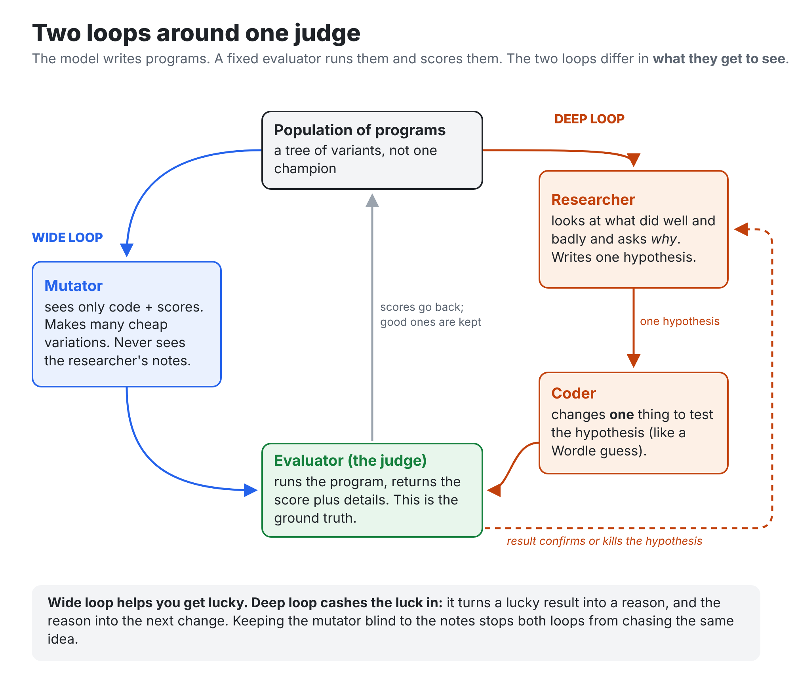

# Helix

**A team of AI agents that writes programs to solve hard problems and keeps improving them, round after round.**
Two loops work side by side around one exact scorer: a reasoning loop that forms a hypothesis about why programs score
as they do and tests one change at a time, and an exploring loop that varies programs without any plan. A memory of
what was tried, and what it showed, carries the work from round to round.

Built by Shreyas Naik (with Sai Vikram for the first version, at a hackathon on October 11, 2026, Luminal's track
*"Build a Self-Improving Agent Team"*), then developed through ten versions to November 2026.

> **Status (November 3, 2026): paused.** Every run, with all its records, is on GitHub (see "Where everything is").
> Any run can be restored exactly and continued.

## Results

The main test problem is the **second autocorrelation inequality**, an open problem in analysis: find a non-negative
step function f that makes R(f) = ‖f∗f‖₂² / (‖f∗f‖₁ · ‖f∗f‖∞) as large as possible. Each function found proves a lower
bound on an unknown constant. A result can't be faked (anyone can compute it from the function), and AlphaEvolve and
later AI systems report their results on it, so it has a public scale.

Every Helix run starts from a constant function (R = 2/3), and every number below is re-checked by exact rational
arithmetic. The evidence for each row, with its sources and what each comparison doesn't control for, is in
**[docs/RECORDS.md](docs/RECORDS.md)**.

### The runs

All on **one Oracle Cloud VM** (Ampere A1, ARM, **2 cores, 12 GB RAM, no GPU**, shared with other jobs), with **one
model for every agent, DeepSeek V4.1 Flash** (through Luminal's API), no training, and 6 programs a round (3 planned
experiments, 3 mutations). Each program runs single-threaded under a hard CPU-time limit; at most 2 run at once.

| Run | Helix version | Starts from | Outside input to the agents | Rounds | Programs | CPU limit per program | Step limit | Best R | Certified bound (exact) | Records |
|---|---|---|---|---|---|---|---|---|---|---|
| A. `atlas-s1` | v4 | constant function | none | 0-150 | 901 | 30 s | 200,000 | 0.940794544359 | 0.940794543119 | [v4](results/v4/atlas-s1/) (rounds 1-20), [v4 continued](results/v4cont/atlas-s1/) (0-150) |
| B. `v47-s2` → `v7-s1` → `v8-s1` | v4.7, then v7, then v8 | run A's best program, with an empty memory | none | 150-700 | 3,625 | 60 s | 1,000,000 | **0.941441743993** | 0.941441740905 | [v4.7](results/v47warm/v47-s2/), [v7](results/v7warm/v7-s1/), [v8](results/v8warm/v8-s1/) |
| C. `v102-helix` | v10.2 | constant function | a written summary of published methods ([list](helix10/sota.py)); no constructions or code | 0-400 | 2,564 | 150 s | 50,000 | **0.948610408760** | 0.948610407407 | [v10.2 seed 1](results/v102/v102-helix/) |
| D. `v102-helix-s2` | v10.2 | constant function | the same | 0-400 | 2,563 | 150 s | 50,000 | 0.941244146241 | 0.941244144332 | [v10.2 seed 2](results/v102/v102-helix-s2/) |

Runs A and B are one line of work: B continued from A's best program, so nothing from outside entered at any point.
Each run's folder has every program with its code and score, every model call with its full prompt and reply, every
round, the settings and the best construction (`best.npy`). The job scripts: [v4](scripts/run_v4_jobs.sh),
[v4.7](scripts/run_v47_warm.sh), [v7](scripts/run_v7_warm.sh), [v8](scripts/run_v8_warm.sh),
[v10.2](scripts/run_v102.sh).

### What they beat

| Published result | Value | Source | Beaten by run | Round | The program that did it | Its R |
|---|---|---|---|---|---|---|
| AlphaEvolve, first result (Google DeepMind, May 2025) | 0.8962 | [DeepMind](https://github.com/google-deepmind/alphaevolve_results) | A | 10 | [`p0057`](results/records/v4_atlas-s1_p0057.py) | 0.907611 |
| Best result by human researchers (Jaech & Joseph, Aug 2025) | 0.941362 | [arXiv:2508.02803](https://arxiv.org/abs/2508.02803) | B | 352 | [`p1324`](results/records/v8warm_v8-s1_p1324.py) | 0.941364 |
| AlphaEvolve, first result | 0.8962 | as above | C | 4 | [`p0021`](results/records/v102_v102-helix_p0021.py) | 0.897662 |
| Best of 25,600 samples (gpt-oss-120b, 10 min each) | 0.9344 | [TTT-Discover](https://arxiv.org/abs/2601.16175), Table 2 | C | 24 | [`p0146`](results/records/v102_v102-helix_p0146.py) | 0.937953 |
| Jaech & Joseph | 0.941362 | as above | C | 26 | [`p0161`](results/records/v102_v102-helix_p0161.py) | 0.944645 |
| ThetaEvolve without RL (8B model, 51,200 programs) | 0.9434 | [ThetaEvolve](https://arxiv.org/abs/2511.23473), Table 2 | C | 26 | [`p0161`](results/records/v102_v102-helix_p0161.py) | 0.944645 |
| OpenEvolve (gpt-oss-120b, 25,600 programs of up to 10 min) | 0.9449 | [TTT-Discover](https://arxiv.org/abs/2601.16175), Table 2 | C | 27 | [`p0164`](results/records/v102_v102-helix_p0164.py) | 0.945662 |
| ThetaEvolve with RL at test time (8B model, 33,280 programs) | 0.9469 | [ThetaEvolve](https://arxiv.org/abs/2511.23473), Table 2 | C | 227 | [`p1419`](results/records/v102_v102-helix_p1419.py) | 0.947592 |

The best programs themselves: run B's [`p3596`](results/records/v8warm_v8-s1_p3596.py) and run C's
[`p2563`](results/records/v102_v102-helix_p2563.py). Each linked file is the program's code exactly as the run
recorded it, with its run, round, parent, score and the file holding that round's model calls.

Run D, the second seed of C, passed AlphaEvolve (round 52) and best-of-25,600 (round 101), but none of the others.

### What they didn't beat

| Result | Value | Steps | Helix's best at that size |
|---|---|---|---|
| TTT-Discover (gpt-oss-120b trained during the run, Jan 2026) | 0.9591 | 50,000 | 0.948610 (run C) |
| AlphaEvolve V2 (Nov 2025) | 0.9610 | 50,000 | 0.948610 (run C) |
| Best known: EinsteinArena's leaderboard #1 (Jul 2026, polished on GPUs) | 0.963588 | 1,999,999 | — |

Two runs started from other people's best constructions (v10 and v10.1) made no meaningful gain: +3.8e-8 on the
leaderboard's #1 (it takes +1e-5 to count) and +2.6e-13 on the best construction with at most 100,000 steps.

Check them yourself (a few minutes on a laptop):

```bash
git clone https://github.com/cybercryptixcoder/helix_evolve && cd helix_evolve
pip install numpy scipy
python tools/verify_ac2.py --alphaevolve-may-2025 \
  results/v4/atlas-s1/best.npy results/v8warm/v8-s1/best.npy results/v102/v102-helix/best.npy
```

**On nine other optimisation problems** (knapsack, scheduling, set cover, travelling salesman, vehicle routing,
job-shop, graph colouring, 1D and 2D bin packing), Helix v3 beat each problem's textbook rule on instances it never saw
during the search, with no change to the system between problems ([table](docs/RECORDS.md#other-problems-helix-v3-october-17)).

## How it works



Each round:
1. **The exploring loop** picks parent programs from everything found so far and asks the model for variants. It sees
   only code and scores, never the plan, so it stays a source of surprises.
2. **The reasoning loop** reads a map of its memory and opens only what it needs; a planning agent decides what to
   test next, why, and what it expects; coding agents write those experiments.
3. **The scorer** (plain code, no model) runs every program under a CPU-time limit and scores it exactly.
4. **A recording agent** turns the results into findings, each tied to its evidence, and adds them to the memory.

Nothing is deleted, and no agent keeps a conversation: only the programs and the memory carry over. The exploring loop
gets lucky; the reasoning loop works out why, and builds on it.

Later versions add what the traces showed was missing: side lines of exploration judged on their own progress (v7), a
register of the distinct solution families found, measured by code (v8), a map of the design choices behind every
program (v9), the published methods as choices on that map (v10), and new designs built from nothing and judged on
their own climb (v10.2). Every version, what it tried, and what happened: [docs/VERSIONS.md](docs/VERSIONS.md).

## Reproducing a run

The record runs used the job scripts in [`scripts/`](scripts/) (for example
[`scripts/run_v102.sh`](scripts/run_v102.sh); its header lists every setting) on the machine described above, with
the settings recorded in each run's `summary.json`. A run needs an API key for DeepSeek V4.1 Flash on Luminal, in a
`.env` file ([LUMINAL.md](docs/jobs/LUMINAL.md)). A new run is a new sample: the model's replies aren't seeded, so the numbers
differ from run to run, as the two v10.2 seeds did.

To continue one of these runs exactly where it stopped, restore its folder (next section) into `runs/` and start its
job script again with more rounds (`GENS=...`): every job resumes from its saved state.

## Where everything is

| What | Where |
|---|---|
| Every run's records: every program with its code and score, every model call with its full prompt and reply, every round, the settings, the best construction | [`results/`](results/), one folder per version and run |
| Every construction of the later runs (thousands per run) | GitHub releases `constructions-*` ([helix9/vault.py](helix9/vault.py)) |
| A byte-for-byte copy of every run folder as it was on the machine, with every file's SHA-256 | GitHub releases `archive-*`; restore with `python3 tools/offload.py restore --unit <unit> --out <dir>` ([docs/OFFLOAD.md](docs/OFFLOAD.md)) |
| The published constructions used for comparison | [`data/field_ac2/`](data/field_ac2/) |
| Design documents, job instructions, analyses of every run, the working history | [`docs/`](docs/) (index: [docs/README.md](docs/README.md)) |
| The research question this work became | [docs/research/RESEARCH_CASE.md](docs/research/RESEARCH_CASE.md) |
| The first README (hackathon to October 2026), with the bin-packing runs | [docs/history/README_2026-10.md](docs/history/README_2026-10.md) |

## The code

Each version of Helix is its own package, kept side by side so every past run can be reproduced exactly:

| Folder | What |
|---|---|
| [`helix/`](helix/) | v1-v2, the hackathon loop (bin packing), with a dashboard ([`ui/`](ui/)) |
| [`helix3/`](helix3/) | v3: the multi-problem version, run on the nine problems in [`suite/`](suite/) |
| [`helix4/`](helix4/) | v4: two loops with a memory of findings, and the autocorrelation problem |
| [`helix47/`](helix47/), [`helix5/`](helix5/), [`helix6/`](helix6/) | v4.7, v4.5/v5, v4.6/v6 |
| [`helix7/`](helix7/), [`helix8/`](helix8/), [`helix9/`](helix9/), [`helix10/`](helix10/) | v7-v10.2, each building on the last |
| [`evaluator/`](evaluator/), [`programs/`](programs/), [`problems/`](problems/) | the first version's evaluator, starting programs and problems |
| [`scripts/`](scripts/) | the job script behind every run (`run_v*.sh`) and the offload |
| [`tools/`](tools/) | the independent verifier (`verify_ac2.py`), run analysis, the archive tool |
| [`viz/`](viz/), [`demo/`](demo/) | run viewers |
| [`tests/`](tests/) | the test suites, one per version |

## Running it

```bash
pip install -r helix/requirements.txt
python -m helix.run --fake-llm --generations 2    # the original loop, offline, no key needed
python -m helix.ui                                # its dashboard at http://127.0.0.1:8765
```

The autocorrelation versions run from their job scripts (`scripts/run_v*.sh`, each with a `FAKE=1` test mode);
[docs/jobs/AETHER.md](docs/jobs/AETHER.md) describes how long jobs are run on the cloud machine.
