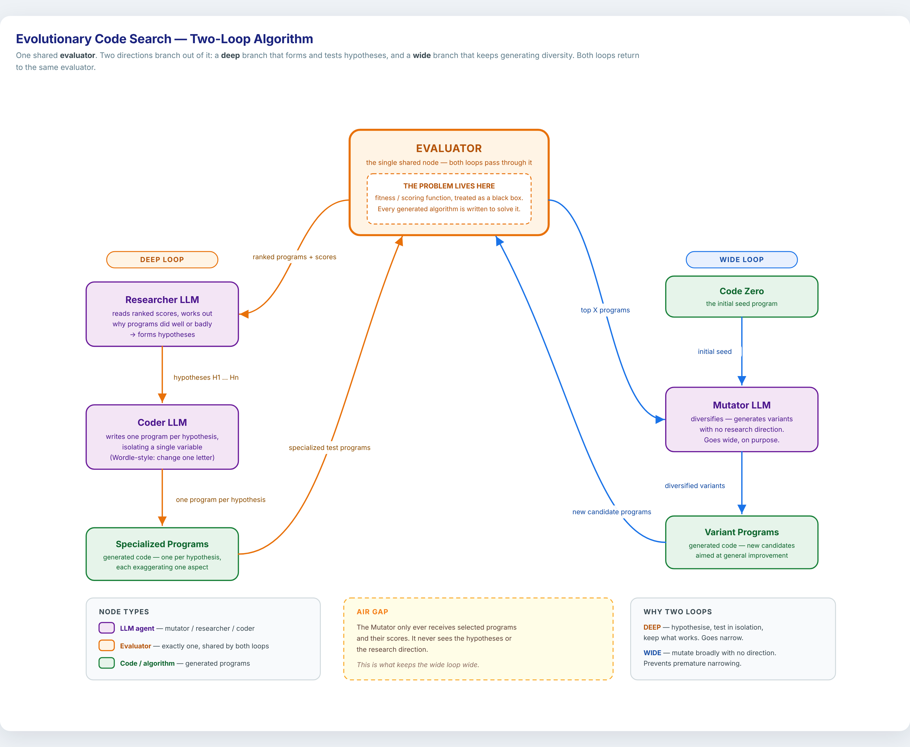
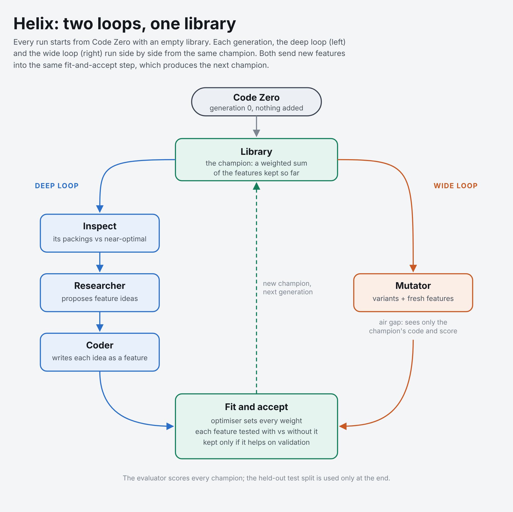

# Helix

**A team of AI agents that takes a deliberately bad program and keeps improving it, round after round, through two loops working side by side: a deep loop that reasons about why programs work, and a wide loop that explores without direction. Both loops share one evaluator.**

Helix was built by Shreyas Naik and Sai Vikram at a hackathon on October 11, 2026, for Luminal's track *"Build a Self-Improving Agent Team"*, and developed further on October 12. This page explains what we set out to build and why. [HANDOFF.md](HANDOFF.md) has the full story: how it works, every run, what we learned, the mistakes, and what is still unknown.

> **Helix v4.7 (October 22, 2026, night)**: v4 without the false ceiling ([docs/V47_DESIGN.md](docs/V47_DESIGN.md)).
> The 150-generation v4 run stalled through mechanisms in the machinery, not the model's ideas
> ([docs/V4_CEILING.md](docs/V4_CEILING.md)):
> - new ideas were erased by the fallback to the start;
> - every idea was judged against the champion at once;
> - the memory map became 45 confirmed failures;
> - 1e-9 changes counted as gains.
>
> v4.7 changes:
> - **Always:** alternative constructions are kept, gains have a noise floor, failures are scoped to their
>   construction, and plans aim at targets.
> - **Only while stalled:** a step-change slot, and a challenger line judged against itself.
>
> `helix47/`, `tests/test_helix47.py`, job `scripts/run_v47_jobs.sh` ([docs/V47_JOB.md](docs/V47_JOB.md)).

> **Helix v4.6 and v6 (October 22, 2026)**: two streams. v4.6 (the Atlas stream: v4 → v4.5 → v4.6) keeps v4's
> two loops and fixes what the full traces showed ([docs/TRACE_STUDY.md](docs/TRACE_STUDY.md)):
> - the wide loop is a halo around the record;
> - every experiment names a method and the state it runs on;
> - the planner splits the CPU among its experiments;
> - an experiment that ran out of time is INCONCLUSIVE, not a failure;
> - plateaus are measured by rate of return;
> - Atlas is organised around ideas.
>
> v6 (the agentic stream: v5 → v6) is an agent that spends each round's compute itself, with three actions
> (experiment, mutate, continue), plus a theory and threads with a rate-of-return stop rule. See
> [docs/V6_DESIGN.md](docs/V6_DESIGN.md) and [docs/V6_JOB.md](docs/V6_JOB.md).

> **Helix v4.5 and v5 (October 21, 2026)**: the v4 job finished with a construction certifying **C2 ≥ 0.9390161**
> on the second autocorrelation inequality (atlas-s1, 42,496 steps, verified in exact arithmetic), above
> AlphaEvolve's first published result for it (0.8963); 4 of its 9 runs passed that value
> ([docs/MILESTONES.md](docs/MILESTONES.md); how the runs climbed, stalled and escaped, from their traces:
> [docs/V4_ANALYSIS.md](docs/V4_ANALYSIS.md)). v4.5 is v4's Atlas with what those traces showed it needed; v5 is a
> continuing researcher (a falsifiable theory, an agenda of threads with stop rules, a notebook with continuity
> built from links, explicit lookups). Both run on one new engine: a portfolio of slot roles every generation
> (deepen / branch / explore), programs that keep their best construction at the CPU limit, stage lines, shared
> gains not counted as evidence, and an elimination check when the search stalls. See
> [docs/V5_DESIGN.md](docs/V5_DESIGN.md) and [docs/V5_JOB.md](docs/V5_JOB.md).

> **Helix v4 (October 20, 2026)** evolves whole programs instead of feature weights, keeps a population (a tree of
> every program) instead of one champion, describes each result in detail, and tests whether **memory across
> generations** helps: a control without memory, an appended and compacted journal, and **Atlas**, a structured
> memory (log, tree of attempts, evidence-backed findings graph) inspired by Avy. The test problem is an open one: the
> second autocorrelation inequality (best known 0.9626; nobody knows the true constant).
>
> ```bash
> python -m helix4.run --condition atlas --gens 20 --out runs/v4/atlas-s1     # one run
> nohup bash scripts/run_v4_jobs.sh > v4_jobs.log 2>&1 &                     # the overnight job (9 runs)
> python -m helix4.report runs/v4 results/v4                                 # the results page
> ```
>
> Start with [docs/V4_DESIGN.md](docs/V4_DESIGN.md) (what, why, and the reasoning behind it) and
> [docs/V4_JOB.md](docs/V4_JOB.md) (running the job).

> **Helix v3 (October 17, 2026)** rebuilds the engine around the same two loops, adding a Navigator over a map of approaches, checked predictions, probes that don't compete, novelty fingerprints and proof-by-certificate pruning. It runs on eight verifiable problems, and a meta loop evolves how Helix searches.
>
> ```bash
> python -m helix3.run binpack2d -g 5        # one run (any of: binpack2d binpack1d tsp knapsack scheduling coloring setcover jobshop)
> python -m ui                               # the dashboard
> python -m meta.outer --help                # the meta loop
> ```
>
> Results (October 17): on 2D bin packing, v3 reached **35.1%** on train and **−5.91** on the held-out test in 15 generations (best before: 34.6%, −6.00, in 25). On the 8 other problems of the suite it beats each problem's textbook heuristic on unseen instances, with no problem-specific changes (`results/v3/`, docs/WORKLOG.md).
>
> Start with [helix3/README.md](helix3/README.md), [docs/V3_DESIGN.md](docs/V3_DESIGN.md) (why each part exists) and [docs/META_V3.md](docs/META_V3.md). The rest of this page describes the original system (v1/v2), which still runs.

---

## The vision

Start from the dumbest reasonable program, **Code Zero**, and let a team of LLM agents improve it with nothing else: no hand-written improvements, no hints, no head start. Measure every round against that same starting point, and finally on fresh test cases the search never saw. The question isn't only *how good* the final program gets. It's whether the **structure of the team** makes it improve *faster and further*. Because every run starts from the same Code Zero, runs with different structures can be compared fairly.

The structure we proposed has two loops around one evaluator:



*The original concept flowchart, from the start of the project ([HTML](docs/original_concept.html)).*

- **One shared evaluator.** The problem lives inside it, and it scores every program as a black box. Both loops pass through it, so their results are directly comparable.
- **The deep loop thinks.**
  - A *Researcher* reads the ranked programs and their scores, works out *why* some did well and others badly, and turns that into hypotheses.
  - A *Coder* writes one program per hypothesis, changing a single thing, like changing one letter in Wordle, so each result says something specific.
  - It keeps what works and goes narrow on purpose.
- **The wide loop explores.** A *Mutator* takes the best programs and writes variants with no research direction. It goes wide on purpose, so the search doesn't narrow too early around one idea.
- **The air gap.** The Mutator only ever sees programs and their scores, never the hypotheses or the research direction. That's what keeps the wide loop wide: if it could read the research, it would follow it, and the team would lose its diversity.
- **Code Zero** seeds both loops. It's First Fit (every bin scores the same, so the oldest bin that fits wins): the honest baseline that every gain is measured from.

Most LLM program search is a single loop of mutation and selection: the wide loop on its own. Helix adds a second, scientific loop beside it and keeps the two apart, to find out whether reasoning and exploration together beat exploration alone. (`--mode wide-only` and `--mode deep-only` run each loop alone as controls.)

## The problem

**Online 2D vector bin packing**, which is how a cloud places virtual machines on servers. Jobs arrive one at a time, each needing some CPU and some memory. Each must be placed at once and for good, on a server with room in both resources or on a new server. Use as few servers as possible.

We chose it because:
- it's measurable;
- it's hard (hard even offline, and here no job can be seen in advance);
- it has well-known heuristics to compare against;
- the best possible packing can be bounded, so we can say how far from perfect a program is, not just how much better than Code Zero.

The agents write one function, `priority(item, bins, capacity)`, which scores the bins a job could go into; the simulator picks the highest. [CONTRACT.md](CONTRACT.md) has the exact rules.

Progress is shown in three units:
- **The evaluator's score:** −(mean % of bins above a simple lower bound). Code Zero scores −9.18.
- **Waste:** extra bins per 100 that the optimal packing needs.
- **Progress to optimal:** 0% = Code Zero, 100% = the optimal packing.

The best classic online heuristic scores 8.9% progress. An offline packer that sees every job in advance scores 40.8%.

## How it's built

The idea stayed the same; *what* the agents write changed once.

**Program engine (version 1, runs 1-3).** Agents write whole programs, numbers included, close to the original concept:
- the Researcher works out why the best program wins by knocking out one part at a time, then proposes improvements;
- Coders write them;
- the Mutator writes variants;
- a small optimiser tunes the numbers in the best programs.

**Feature engine (version 2, the current default).** The first runs showed the agents were good at ideas and bad at numbers, and were judging programs from scores alone. So the work was split:
- agents write *features*: small functions that each measure one thing about a candidate bin;
- an optimiser sets how much each feature counts;
- a feature is kept only if it helps on validation instances the fitting never saw, compared with the same fit without it;
- the Researcher now also sees *how* the policy packs compared with a near-optimal packing of the same jobs. The Mutator still sees only code and a score.



*The two loops in the current engine ([HTML](docs/helix_loops.html)). [HANDOFF.md](HANDOFF.md) §6-7 has both engines step by step.*

## Where it stands

| Run | Engine | Generations | Best on train | Progress to optimal | Held-out test | Notes |
|---|---|---|---|---|---|---|
| 2 | programs | 30 | −6.793 | 27.4% | −6.755 (25.0%) | The reference run |
| 3 | programs | 17 | −7.511 | 19.1% | −7.161 | Most agent replies were cut off by the model's hidden thinking |
| 4 | features | 10 | −6.185 | 34.3% | −5.971 | **Not comparable:** started from a hand-written head start by mistake (since removed) |
| 5 | features | 10 | −6.986 | 25.1% | −6.703 (25.6%) | The first clean feature-engine run from Code Zero |
| 6 | features (fast loop) | 10 | −7.034 | 24.6% | −6.686 (25.8%) | |
| 7 | features (fast loop) | 25 | **−6.156** | **34.6%** | **−6.001 (33.7%)** | Best from scratch so far |
| 8 | features (fast loop) | 5 | −6.774 | 27.5% | −6.645 (26.2%) | A short look at what the agents actually do; replay it with `results/20261017-014858-full/viewer.html` (download, open in a browser) |
| v3 cloud | **v3** | 13 | −6.75 | 28.7% | 28.8% | Plateaued from generation 4; crashed at 14 on a fixed bug (`results/v3/bp2d-25`) |
| v3 round 6 | **v3** | 15 | **−6.115** | **35.1%** | **−5.910 (33.7%)** | **Best so far**: plateau broken at generations 7 and 14 by features conditioned on large items (`results/v3/bp2d-r6-15`) |

Every run's full trace (every agent call with its reasoning, every program, generation and feature) is in [`results/`](results/). Run 1 (the first hackathon runs) wasn't kept.

Any feature-engine run can be replayed as an interactive page: `python -m viz.export results/<run>` (see [viz/](viz/README.md)).

## Read next

| | |
|---|---|
| [HANDOFF.md](HANDOFF.md) | Everything: origin, design, repo map, both engines, every run, what we learned, mistakes, working rules, unknowns, next steps |
| [LUMINAL.md](LUMINAL.md) | Using the Luminal model API: the settings that work and how we found them |
| [CONTRACT.md](CONTRACT.md) | The problem, the program interface and the evaluator |
| [helix/README.md](helix/README.md) | The search loop: dashboard, commands, options |
| [evaluator/README.md](evaluator/README.md) | The evaluator and the baselines |
| [results/](results/) | Full traces of every run |
| [docs/next-concept/](docs/next-concept/) | The next concept: treating improvement as a search space of approaches, pruned by LLM reasoning |
| [docs/META_LOOP.md](docs/META_LOOP.md) | Plan for a meta loop that evolves Helix itself, scored by a multi-problem evaluator (not built yet) |
| [viz/](viz/README.md) | The run viewer: replays a run as a factory floor, with every message, feature and champion readable |
| [docs/WORKLOG.md](docs/WORKLOG.md) | What has been done since the handoff, what each step found, and what was decided |

## Quick start

```bash
pip install -r helix/requirements.txt
python -m helix.ui                       # dashboard at http://127.0.0.1:8765
python -m helix.run --fake-llm --generations 2    # offline test, no key needed
```

A real run needs a Luminal API key (see [LUMINAL.md](LUMINAL.md)); paste it under **Connect** on the dashboard.
