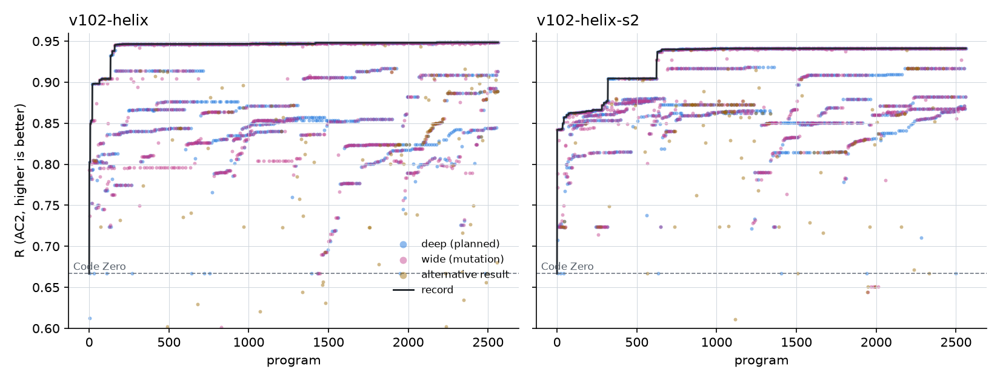
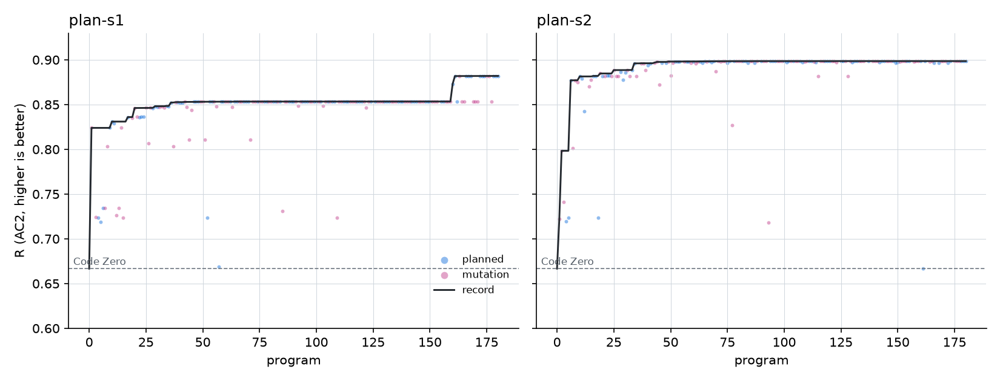

# Is the wide loop redundant? (November 6, 2026)

Shreyas's question (Nov 5): in the score plots the deep loop climbs, while the mutator "occasionally produces stuff
as good as the best and often produces outputs worse than even Code Zero, or at par with it". So is the wide loop
redundant, or is this expected?

Everything below comes from the program records: v10.2 (`results/v102/`), v4 (`results/v4/`) and the lean
experiments (`results/lean/`). Plots: `tools/plot_roles.py`.

## What the programs show

**In v10.2, wide and deep programs score alike.** Both sit on the same horizontal bands. Each band is one track (an
exploration built from nothing) being polished: v10.2's wide loop works the explorations' own lines by design, and
so does the deep loop. The table measures how far each program got, as a fraction of the way from Code Zero to the
record at that moment:

| Run | Role | Programs | Median progress | Within 1% of the record | At or below Code Zero | Share of total gain |
|---|---|---|---|---|---|---|
| v10.2 seed 1 | wide | 1,200 | 0.71 | 32% | 1% | **68%** |
| | deep | 1,200 | 0.73 | 34% | 1% | 32% |
| | alternative result | 163 | 0.62 | 6% | **16%** | 0% |
| v10.2 seed 2 | wide | 1,200 | 0.87 | 31% | 1% | **76%** |
| | deep | 1,200 | 0.88 | 34% | 1% | 24% |
| | alternative result | 162 | 0.71 | 9% | **9%** | 0% |

- **The points near or below Code Zero are mostly not the mutator's.** They are the "alternative result" (gold),
  v4.7's second output per program. It made none of the gain, and lean doesn't carry it over.
- **The wide loop polishes weaker tracks** because its parents are on those tracks, not because it's worse at
  writing programs. The deep loop's programs on the same tracks score the same.
- **Most of the gain came from the wide loop:** 68% and 76%, from only 4-8% of its programs setting records. In v4
  it was 73-76% (the atlas and control runs, seed 1).

**In lean,** every program starts from its parent's result, so most mutations land at or just above their parent.
In experiments 2-4, 0-2% of mutations scored at or below Code Zero, and the share of planned programs was about the
same (0-6%).

## Is it expected?

Yes. A mutation loop samples parents from the whole population, weaker ones included, on purpose, to keep more than
one line alive. So most of its children sit near their parent, below the record. The useful question isn't how many
children are poor, but whether the loop sets records that nothing else would. Two measures say it does:
- **Its share of the gain:** 68-76% in v10.2 and v4.
- **The lean ablation:** the planner without mutations (planned-only) was never the best setup on any of four
  problems. The best setup on each always had mutations: plan on 32 circles and AC1, the plainest mutation loop
  (floor) on AC2.

## What stays open

- **"Set the record" may mean "polished the deep loop's idea first".** The share of gain can't separate the two. The
  ablation can, and it says the mutations aren't redundant: removing them never helped.
- **Folding the mutations into the planner** (one loop that chooses between polishing and exploring) is still a fair
  design to test against two loops. It belongs with the exploration work (P3-P5 in `docs/LEAN_PLAN.md`).
