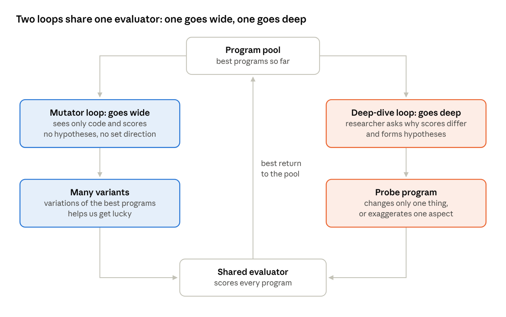
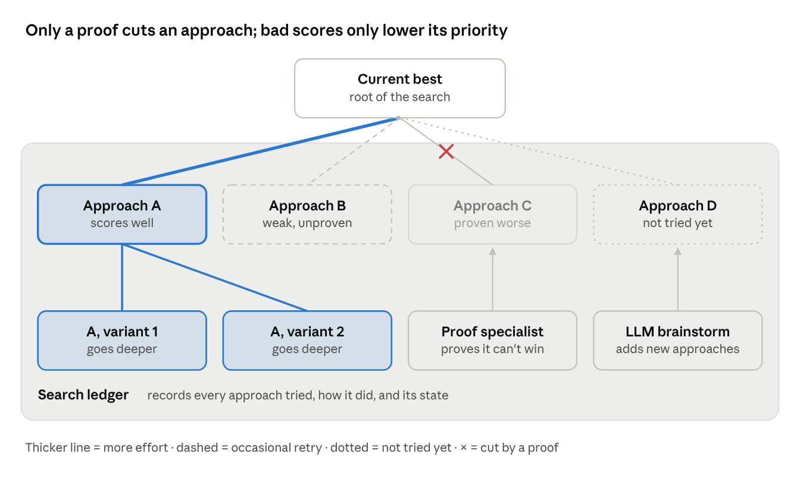

# Treating improvement as a search space

*The next concept for Helix.*

Oct 14, 2026 · @Shreyas

## Overview

Helix is an LLM-based evolutionary system that improves programs, built by Shreyas with a close friend who's also academically inclined. It already partly works and can be demoed: it has been tried on 2D bin packing. The next step is to treat improvement itself as a search space.

- **What it does:** it keeps producing new versions of programs, scores every version with an evaluator, and keeps the best ones in a pool.

- **What already exists:** two search loops, one wide and one deep, around one shared evaluator.

- **What comes next:** laying out the ways a program could be improved as a space of approaches, searching that space by coding and evaluating each approach, and pruning it with LLM reasoning.

- **Code:** the [helix_evolve repository](https://github.com/cybercryptixcoder/helix_evolve).

This document collects everything said about the project in one conversation: the ideas, the reasoning behind them, the diagrams, every version of the write-up, and the open questions. It leaves out the tech stack on purpose.

## Short description

The system runs two search loops at once: one goes wide, making undirected variations, and the other goes deep, testing why things work. The next step is to see whether the ways an algorithm could be improved can be laid out as a space we can actually search, with LLM reasoning used to cut off the directions that can be shown not to help.

This description was written to say what is interesting about the project, not to state a problem. For this project, Shreyas asked for the focus to be the interesting part rather than a problem statement.

## The current system: two loops around one shared evaluator

Helix runs two loops that share one evaluator, instead of one agent that reasons and implements in a single loop. One loop goes wide and the other goes deep.

**The usual setup it departs from.** Conventional setups have one agent that reasons about possible improvements and carries them out in a single loop. In that setup, the search can narrow around one idea too early.

**The parts:**

- **Program pool:** holds the best programs found so far. Both loops start from it, and the best results go back into it.

- **Mutator loop (goes wide):** keeps producing variations of the best programs, with no particular direction. It only ever sees code and scores. It is kept blind to any hypotheses on purpose, so the search doesn't narrow too early around one idea.

- **Deep-dive loop (goes deep):** a researcher looks at which programs did well or badly and forms hypotheses about why. Each hypothesis is tested by writing a version of the program that changes only that one thing, or exaggerates one aspect. The sole intent of that version is to probe whether the change affects the score in any way. These probe programs exist to learn something, not to win.

- **Shared evaluator:** results from both loops go back through the same evaluator, and the best go back into the pool.

**Why two loops.** In Shreyas's words: the mutator helps us get lucky; the deep-dive loop helps us cash in on that luck. The mutator finds surprising improvements without needing a reason. The researcher then works out what made them work, so the gain can be understood and pushed further.

Helix today · two loops, one shared evaluator

Both loops draw on the pool and send their programs to the same evaluator, and only the best results return to the pool.

## The next step: improvement as a search space

The extension treats discovering and improving solutions as a search space made up of approaches: the different ways a program can be modified within certain constraints. In Shreyas's original framing, the axes of the space are formed by the ways a program can be modified given certain constraints.

**Reasoning proposes, the evaluator decides.** The LLM brainstorms the different approaches. Which ones actually work is decided by writing code for each approach and running it through the evaluator. So the search moves by coding different versions of the program at each step, not by reasoning alone.

**A ledger of what has been tried.** The search keeps track of which approaches have been tried and how they did. That way it doesn't keep sinking time into approaches that haven't paid off.

**Effort follows evidence.** Each approach in the space is in one of four states, and the effort it gets depends on that state:

| State          | What it means                                                  | What the search does                                       |
|----------------|----------------------------------------------------------------|------------------------------------------------------------|
| Scores well    | Its versions have done well in the evaluator                   | Gets the most effort, and is expanded into deeper variants |
| Weak, unproven | It hasn't worked well so far, but nothing proves it can't      | Retried occasionally, at a lower priority                  |
| Proven worse   | The proof specialist showed it can't beat what we already have | Discarded completely                                       |
| Not tried yet  | Added by LLM brainstorming                                     | Waits its turn to be coded and evaluated                   |

How the space is pruned, and why that is the hard part, is in the next section.

## Pruning: the hard part

Pruning is the hard part, because a few bad scores don't prove an approach is useless.

**Why it is hard here.** In a math solver, you can prove a branch can't contain a good solution, and cut it safely. In this search, there is no such guarantee. An approach can score badly a few times and still hold a good solution that simply hasn't been found yet.

**The proof specialist.** One way to handle this is a proof specialist agent. Its only job is to prove that a given approach would produce a worse result, meaning it can't beat what we already have. If it succeeds, that approach is discarded completely.

**Weak but unproven approaches stay alive.** If an approach hasn't worked well so far, but nobody has been able to prove it's useless, it is not cut. It is retried occasionally, at a lower priority than the approaches that are more promising.

**The rule that follows.** Only a proof can cut an approach for good. Bad scores only lower its priority. This is what lets LLM reasoning prune the space without throwing away directions that were merely unlucky.

Approach tree · how effort and pruning work

The LLM adds approaches, the evaluator's scores decide how much effort each one gets, and only the proof specialist can remove one for good.

## What makes it interesting

Shreyas named three interesting things about this project, and one reason the whole thing matters.

1.  **Two loops, one wide and one deep.** Most systems have a single loop. Splitting the search into an undirected wide loop and a hypothesis-driven deep loop, sharing one evaluator, is the first interesting part.

2.  **Improvement as a search space.** Can the ways to improve an algorithm be expressed as a search space, and can that space actually be searched?

3.  **Pruning with LLM reasoning.** Can parts of that space be cut using LLM reasoning, such as the proof specialist, without cutting directions that could still pay off?

**Why it matters.** With more capable models on harder problems, this kind of setup has a real chance of making actual discoveries.

## Testing and ambitions

The plan is to test the search-space idea cheaply first, on problems with a clear right answer, before reaching for harder ones.

- **So far:** the two-loop system has been tried on 2D bin packing and can be demoed.

- **Next test:** a range of verifiable problems, using cheap models.

- **Longer term:** more capable models on harder problems, where the setup has a real chance of making actual discoveries.

## How the write-up evolved

The write-up went through two editing passes before it was sent: a light clarity pass that kept Shreyas's wording, then a structural pass on structure and consistency. The original and the final text are below in full.

### Original text (Shreyas's words)

This is an LLM-based evolutionary system I built with a close friend who's also academically inclined. It partly already works and can be demoed (we tried it on 2D bin packing), and we want to develop it further. Conventional setups have one agent that reasons about possible improvements and carries them out in a single loop. Ours runs two loops around one shared evaluator. The mutator loop goes wide: it keeps producing variations of the best programs with no particular direction, and it only ever sees code and scores, so the search doesn't narrow too early around one idea. The deep-dive loop goes deep: a researcher looks at which programs did well or badly and forms hypotheses about why, and each hypothesis is tested by writing a version of the program that changes only that one thing, or exaggerates one aspect, with the sole intent of probing whether that affects the score in any manner. Results from both loops go back through the evaluator, and the best go back into the pool. The mutator helps us get lucky; the deep-dive loop helps us cash in on that luck.

The part we want to expand on is to treat discovering and improving solutions as a search space where the axes are formed by the ways in which a program can be modified given certain constraints. The search is done by coding different versions of the program at each step and running them through the evaluator. The LLM brainstorms the different approaches, but which ones actually work is decided by writing code for each and running it through the evaluator. The search keeps track of which approaches have been tried and how they did, so the model stops spending time on directions that already failed. The hard part is pruning. In a math solver, you can prove a branch can't contain a good solution and cut it safely, but here, a few bad scores don't prove a direction is useless. One way to do this is to add a proof specialist agent whose only task is to prove that a certain approach would result in a worse output. If successful at that, we can completely discard it. In the other case, where an approach hasn't worked well so far but we haven't been able to prove that it is useless, we would occasionally retry that approach with less importance than the approaches that are more favorable. We can test this on a range of verifiable problems using cheap models. With more capable models on harder problems, this kind of setup has a real chance of making actual discoveries, which is what makes it interesting.

### First pass: clarity only

Shreyas asked for small fixes to overly complicated sentences only, keeping the text as close to the original as possible, because it had already been edited heavily.

- "It partly already works" became "It already partly works."

- The long deep-dive sentence was split in two, and "with the sole intent of probing whether that affects the score in any manner" became "purely to probe whether it affects the score at all."

- Two back-to-back sentences both said approaches are tested by coding them and running them through the evaluator. They were merged into one.

- "So the model stops spending time on directions that already failed" became "doesn't keep spending time." The original contradicted the later point that weak approaches are occasionally retried.

- "One way to do this is to add a proof specialist agent whose only task is…" became "One way to handle this is a proof specialist agent whose only job is to prove that a given approach would produce a worse result."

- The retry sentence was simplified to: "If an approach hasn't worked well so far but we can't prove it's useless, we occasionally retry it, at a lower priority than more promising approaches."

### Second pass: structure and consistency

Shreyas asked whether the framing held together, whether anything contradicted itself, and for one consistent structure.

- **One order:** what's done today and why it falls short, then what we do instead and how it works, then where it stands and how we'd test it.

- **Said what's wrong with one loop.** The original said conventional setups use a single loop but not why that's a problem. "Where the search can narrow around one idea too early" was added, reusing Shreyas's own point from the mutator sentence.

- **One word for one thing.** "Axes," "directions," "approaches" and "branches" all named the same thing. It became "approaches" throughout, with "branch" kept only in the math-solver comparison.

- **Worse than what.** "Proves an approach would produce a worse result" became "can't beat what we already have."

- **Status moved to the end.** The friend, the partial build and the bin-packing demo moved from the first paragraph to the last.

- **Smaller rewordings:** the opening became "This is an LLM-based evolutionary system that improves programs," and the ledger sentence became "so it doesn't keep sinking time into approaches that haven't paid off."

### Final text

This is an LLM-based evolutionary system that improves programs. Conventional setups have one agent that reasons about possible improvements and carries them out in a single loop, where the search can narrow around one idea too early. Ours runs two loops around one shared evaluator. The mutator loop goes wide: it keeps producing variations of the best programs with no particular direction, and it only ever sees code and scores, so the search doesn't narrow too early around one idea. The deep-dive loop goes deep: a researcher looks at which programs did well or badly and forms hypotheses about why. Each hypothesis is tested by writing a version of the program that changes only that one thing, or exaggerates one aspect, purely to probe whether it affects the score at all. Results from both loops go back through the evaluator, and the best go back into the pool. The mutator helps us get lucky; the deep-dive loop helps us cash in on that luck.

The part we want to expand on is treating the discovery and improvement of solutions as a search space made up of approaches: the different ways a program can be modified within certain constraints. The LLM brainstorms different approaches, but which ones actually work is decided by coding a version of the program for each and running it through the evaluator. The search keeps track of which approaches have been tried and how they did, so it doesn't keep sinking time into approaches that haven't paid off. The hard part is pruning. In a math solver, you can prove a branch can't contain a good solution and cut it safely, but here, a few bad scores don't prove an approach is useless. One way to handle this is a proof specialist agent whose only job is to prove that a given approach can't beat what we already have. If it succeeds, we can discard that approach completely. If an approach hasn't worked well so far but we can't prove it's useless, we occasionally retry it, at a lower priority than more promising approaches.

I built this with a close friend who's also academically inclined. The system already partly works and can be demoed (we tried it on 2D bin packing), and the search-space part is what we want to develop next. We can test it on a range of verifiable problems using cheap models. With more capable models on harder problems, this kind of setup has a real chance of making actual discoveries, which is what makes it interesting.

## Open questions

One gap in the framing was found during the structural pass and deliberately left for later, because something sent is better than nothing perfected.

- **How do the two loops and the search space fit together?** As written, they read as two separate systems. The approach tree could replace the two loops, sit above them and decide where they search, or use the deep-dive loop as the way each approach gets explored. One sentence in the write-up would connect them once this is decided.
