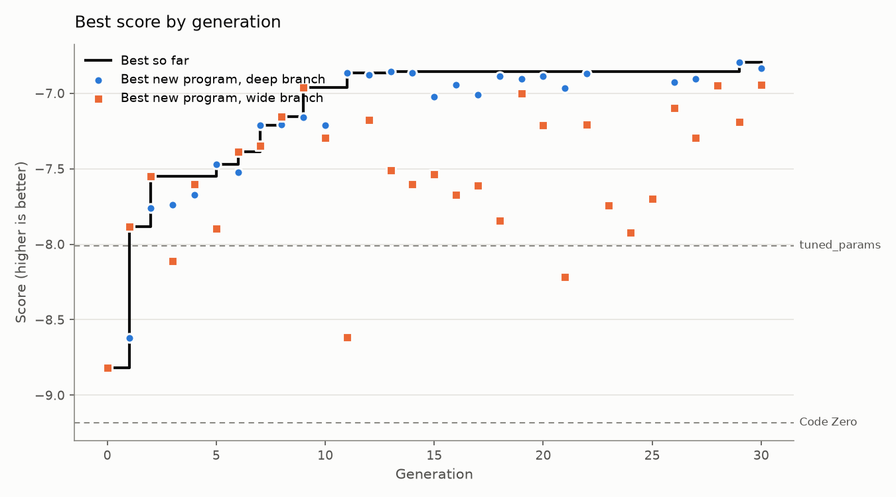

# Run report: 20261011-185558-full

- Mode: **full**, schedule parallel, 30 generations after Code Zero
- Models: deepseek-ai/DeepSeek-V4.1-Flash
- LLM calls: 423 (1,433,858 tokens in, 1,434,639 out)
- Best train score: **-6.793** (Code Zero -9.181)

## Held-out check

Scored on the evaluator's `test` split: new instances, plus families the search never saw (lognormal, wide).

| Program | Train score | Test score | Test excess % on lognormal | Test excess % on wide |
|---|---|---|---|---|
| Evolved best (p0279, deep) | -6.793 | -6.755 | 5.23 | 4.43 |
| Code Zero | -9.181 | -8.909 | 10.31 | 5.48 |
| Baseline: alphaevolve_borg | -12.652 | -11.966 | 9.16 | 9.65 |
| Baseline: best_fit | -8.774 | -8.772 | 10.14 | 5.22 |
| Baseline: dot_product | -8.392 | -7.960 | 7.04 | 5.35 |
| Baseline: tuned_params | -8.009 | -7.390 | 6.55 | 4.56 |

## Where the improvements came from

| Generation | Branch | Program | Score | Gain | What it did |
|---|---|---|---|---|---|
| 0 | wide | p0005 | -8.819 | +0.363 | *Idea: a graded "best-fit on the tighter resource, with a scarcity-aware nudge toward the new bin."** The all-zeros baseline is plain First Fit, which wastes sp |
| 1 | wide | p0008 | -7.883 | +0.935 | We need design a new priority function for online 2D vector bin packing. We want improve over score -8.819. Need think about what's limiting. The current best p |
| 2 | wide | p0018 | -7.551 | +0.332 | Idea: instead of scoring by leftover tightness, score by **how much the placement improves the bin's balance** — favor bins where the item pushes the two remain |
| 5 | deep | p0057 | -7.469 | +0.082 | h0010 showed balance is the champion's dominant lever (-0.740) and h0012 (balance 1.25) lost slightly, so 1.0 is near-optimal. But h0016's cosine transplant (a  |
| 6 | wide | p0061 | -7.388 | +0.081 | The family of programs here all score bins by the *leftover* after placement, which mixes together two different goals: consolidating now and keeping a bin usef |
| 7 | deep | p0077 | -7.211 | +0.176 | h0013 showed compact is the single most load-bearing term on this line (-72.3 when removed), and h0011/h0014/h0017 mapped a peaked curve around 0.55 on p0057. p |
| 8 | wide | p0080 | -7.153 | +0.058 | I need to write a new priority function. Let me think about what could improve on the -7.211 program. The problem is online 2D vector bin packing. Common good h |
| 9 | wide | p0088 | -6.961 | +0.192 | Need write program, one function, numpy only. Need higher score than -7.153. We need propose idea. Let's think about online 2D VBP. Existing programs score well |
| 11 | deep | p0115 | -6.864 | +0.097 | h0037 showed fit is by far the biggest lever (-12.123, worst in bimodal +24.65, correlated +15.54, large +14.69), so its weight sits on a steep slope. h0027 (fi |
| 13 | deep | p0137 | -6.855 | +0.009 | h0045 showed fit is the dominant lever (-12.220, bimodal +24.52, correlated +15.67, large +14.60) and h0047 showed stepping it down to 0.95 costs -0.243, so the |
| 29 | deep | p0279 | -6.793 | +0.062 | h0085 (skew-coefficient 0.35) was the best comp variant at only -0.012 overall, essentially break-even on the champion. The remaining damage is concentrated in  |

## Branches

| Branch | Programs | Valid | Repaired | Duplicates | New bests | Best score |
|---|---|---|---|---|---|---|
| seed | 1 | 1 | 0 | 0 | 0 | -9.181 |
| wide | 186 | 179 | 90 | 0 | 6 | -6.943 |
| deep | 104 | 104 | 0 | 1 | 5 | -6.793 |

## Research log

Verdicts: 75 flat, 16 matters, 9 minor, 3 refuted, 1 no-effect

Supported hypotheses, largest gain first:

| Hypothesis | Base | Gain | Claim | Change | Families that moved most (excess %) |
|---|---|---|---|---|---|

