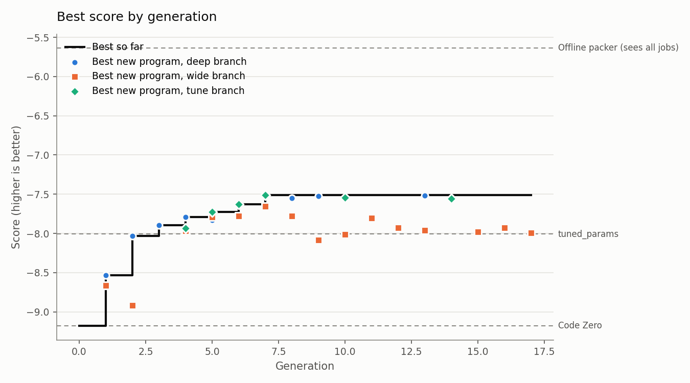

# Run report: 20261012-080715-full

- Mode: **full**, schedule parallel, 17 generations after Code Zero
- Models: deepseek-ai/DeepSeek-V4.1-Flash
- LLM calls: 273 (730,702 tokens in, 991,757 out)
- Best train score: **-7.511** (Code Zero -9.181)

## Held-out check

Scored on the evaluator's `test` split: new instances, plus families the search never saw (lognormal, wide).

| Program | Train score | Test score | Test excess % on lognormal | Test excess % on wide |
|---|---|---|---|---|
| Evolved best (p0074, tune) | -7.511 | -7.161 | 6.22 | 4.30 |
| Code Zero | -9.181 | -8.909 | 10.31 | 5.48 |
| Baseline: alphaevolve_borg | -12.652 | -11.966 | 9.16 | 9.65 |
| Baseline: best_fit | -8.774 | -8.772 | 10.14 | 5.22 |
| Baseline: dot_product | -8.392 | -7.960 | 7.04 | 5.35 |
| Baseline: tuned_params | -8.009 | -7.390 | 6.55 | 4.56 |
| *Reference: offline best-fit decreasing (sees every job in advance)* | -5.634 | -4.905 | 3.61 | 1.43 |

**Progress to optimal** (0% = Code Zero, 100% = the optimal packing, `helix/bounds.py`): **19.1%** on train, **20.3%** on the held-out test split. Extra bins per 100 the optimum needs: 7.01 on train, 6.84 on test.

The score counts bins above a lower bound that ignores job shapes, so 0 can't be reached. As a practical yardstick, an offline packer that sees every job before placing any scores -5.634 on train. The evolved program has closed **47.1%** of the gap between Code Zero and that packer on train, and **43.6%** on the held-out test split (`python -m helix.reference`).

## Where the improvements came from

| Generation | Branch | Program | Score | Gain | What it did |
|---|---|---|---|---|---|
| 1 | deep | p0016 | -8.534 | +0.647 | Minimising total leftover can leave one resource nearly exhausted while the other is wasted, i.e. unbalanced fragments. Minimising the L-infinity leftover keeps |
| 2 | deep | p0026 | -8.033 | +0.501 | L-infinity controls the worst resource but permits one-sided residuals that strand the other resource, which is exactly what hurts anticorr and bimodal; penalis |
| 3 | deep | p0034 | -7.893 | +0.141 | The balance term w*/n_c-n_m/ is what made the champion jump (h0007), but a linear imbalance penalty treats a near-tie (0.05 lopsided) and a badly stranded bin ( |
| 4 | deep | p0044 | -7.790 | +0.103 | The champion's quadratic imbalance penalty (h0009) fixed anticorr but the residual it penalises is measured after placement, so it cannot distinguish a bin that |
| 5 | tune | p0055 | -7.724 | +0.065 | tuned 1 constants of p0044 (+0.065): 0.211→0.2029 |
| 6 | tune | p0066 | -7.630 | +0.094 | tuned 1 constants of p0055 (+0.094): 0.2029→0.179 |
| 7 | tune | p0074 | -7.511 | +0.119 | tuned 2 constants of p0063 (+0.269): 0.5685→0.6302, 0.3→0.3096 |

## Branches

| Branch | Programs | Valid | Repaired | Duplicates | New bests | Best score |
|---|---|---|---|---|---|---|
| seed | 1 | 1 | 0 | 0 | 0 | -9.181 |
| wide | 108 | 36 | 4 | 0 | 0 | -7.657 |
| deep | 32 | 32 | 0 | 0 | 4 | -7.519 |
| tune | 7 | 7 | 0 | 0 | 3 | -7.511 |

## Research log

Verdicts: 16 refuted, 9 supported, 6 flat, 1 no-effect

Supported hypotheses, largest gain first:

| Hypothesis | Base | Gain | Claim | Change | Families that moved most (excess %) |
|---|---|---|---|---|---|
| h0003 | p0001 | +0.647 | Minimising total leftover can leave one resource nearly exhausted while the other is wasted, i.e. unbalanced fragments. Minimising the L-inf | Score = -np.maximum((bins - item)[:,0], (bins - item)[:,1]) (use capacity-relative residuals if untuned): choose the bin whose worst residua | anticorr -1.16, uniform -1.03, bimodal -0.96 |
| h0007 | p0016 | +0.501 | L-infinity controls the worst resource but permits one-sided residuals that strand the other resource, which is exactly what hurts anticorr  | score = -max(n_c,n_m) - w*abs(n_c-n_m) with moderate w (~0.3), n = (bins-item)/capacity. | anticorr -1.74, small -1.25, large -0.27 |
| h0001 | p0001 | +0.268 | All-equal scores give First Fit, which opens bins too eagerly and wastes the tighter resource. Scoring by the total remaining room AFTER pla | Replace the constant score with score = -((bins - item).sum(axis=1)): the summed leftover [cpu,mem] after placing the job, negated so the sm | uniform -0.90, large -0.35, bimodal -0.24 |
| h0004 | p0001 | +0.268 | Opening a new bin is free under First Fit, so bins are opened even when a slightly tighter existing bin would do. Penalising the empty (last | Score = -((bins - item).sum(axis=1)) with a penalty added on the always-empty last row: subtract a moderate constant (scaled to capacity, e. | uniform -0.90, large -0.35, bimodal -0.24 |
| h0009 | p0026 | +0.141 | The balance term w*/n_c-n_m/ is what made the champion jump (h0007), but a linear imbalance penalty treats a near-tie (0.05 lopsided) and a  | Replace the absolute imbalance with a squared one: return -np.maximum(n_c, n_m) - w*(n_c - n_m)**2, with n_c,n_m = (bins-item)/capacity and  | small +0.95, anticorr -0.93, large -0.44 |
| h0013 | p0034 | +0.103 | The champion's quadratic imbalance penalty (h0009) fixed anticorr but the residual it penalises is measured after placement, so it cannot di | Add a squared-difference term between the two residual fractions and the item's own resource split: let f_c = item[0]/capacity[0], f_m = ite | bimodal -0.59, small -0.32, correlated +0.27 |
| h0024 | p0066 | +0.083 | p0066 beats the champion on uniform (3.98) and bimodal (6.52) but lacks any alignment term; transplanting the champion's dot-product alignme | In p0066 add align = 0.3 * (n_c * f_c + n_m * f_m) with n = (bins - item)/capacity, f = item/capacity, keeping its imbalance 0.5685 and shap | large -1.42, bimodal +0.47, anticorr +0.47 |
| h0028 | p0067 | +0.069 | h0024 showed p0066 gains +0.083 from the champion's dot-product alignment, best on large. p0067 is stronger on bimodal/uniform and also lack | In p0067 add align = 0.3*(n_c*f_c + n_m*f_m) with n=(bins-item)/capacity, f=item/capacity, keeping its imbalance 0.5558 and shape 0.2129 ter | large -1.15, anticorr +0.81, small -0.32 |
| h0002 | p0001 | +0.053 | First Fit ignores the shape of the residual, which is fatal when jobs are one-sided (CPU-heavy vs memory-heavy). Preferring bins whose alrea | Score = dot product of the item with the bin's used vector: (item * (capacity - bins)).sum(axis=1). A brand-new bin scores 0, so it is only  | small +0.32, large -0.27, uniform -0.26 |

