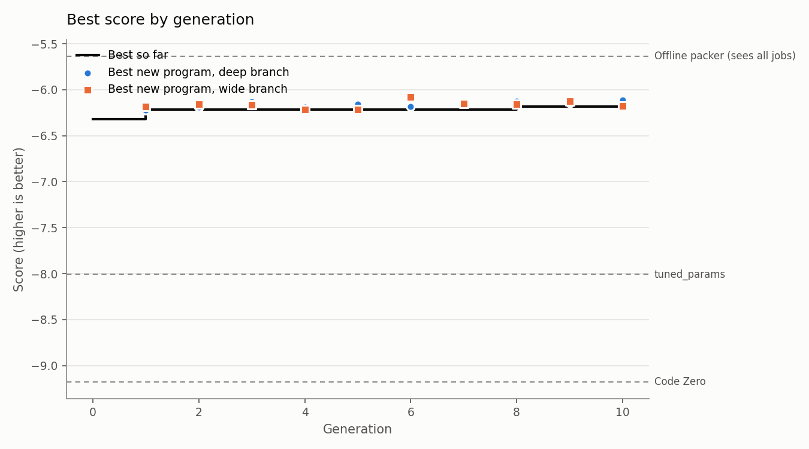

# Run report: 20261012-124038-full

- Engine: **features**, mode **full**, schedule parallel, 10 generations after Code Zero
- Models: deepseek-ai/DeepSeek-V4.1-Flash
- LLM calls: 95 (208,399 tokens in, 39,693 out)
- Best train score: **-6.185** (Code Zero -9.181)

## Held-out check

Scored on the evaluator's `test` split: new instances, plus families the search never saw (lognormal, wide).

| Program | Train score | Test score | Test excess % on lognormal | Test excess % on wide |
|---|---|---|---|---|
| Evolved best (p0060, wide) | -6.185 | -5.971 | 4.09 | 4.56 |
| Code Zero | -9.181 | -8.909 | 10.31 | 5.48 |
| Baseline: alphaevolve_borg | -12.652 | -11.966 | 9.16 | 9.65 |
| Baseline: best_fit | -8.774 | -8.772 | 10.14 | 5.22 |
| Baseline: dot_product | -8.392 | -7.960 | 7.04 | 5.35 |
| Baseline: tuned_params | -8.009 | -7.390 | 6.55 | 4.56 |
| *Reference: offline best-fit decreasing (sees every job in advance)* | -5.634 | -4.905 | 3.61 | 1.43 |

**Progress to optimal** (0% = Code Zero, 100% = the optimal packing, `helix/bounds.py`): **34.3%** on train, **34.1%** on the held-out test split. Extra bins per 100 the optimum needs: 5.69 on train, 5.66 on test.

The score counts bins above a lower bound that ignores job shapes, so 0 can't be reached. As a practical yardstick, an offline packer that sees every job before placing any scores -5.634 on train. The evolved program has closed **84.5%** of the gap between Code Zero and that packer on train, and **73.4%** on the held-out test split (`python -m helix.reference`).

## Where the improvements came from

| Generation | Branch | Program | Score | Gain | What it did |
|---|---|---|---|---|---|
| 0 | fit | p0002 | -6.320 | +2.861 | the textbook features, weights fitted; validation -6.817 |
| 1 | wide | p0003 | -6.214 | +0.106 | added f0005 balanced_fill_ratio; validation -6.503 |
| 8 | wide | p0060 | -6.185 | +0.029 | added f0058 age_discounted_tight_fill; validation -6.430 |

## Features by branch

Each feature is tried by searching its own weights with the rest of the policy fixed; *validation gain* is the change in score on validation instances the fitting never sees, which decides what is kept.

| Branch | Written | Invalid | Tried | Kept | Retired later | Best validation gain |
|---|---|---|---|---|---|---|
| deep | 40 | 0 | 40 | 0 | 0 | +0.029 |
| wide | 40 | 3 | 37 | 2 | 0 | +0.074 |

## The final policy

A weighted sum of 3 features with 20 fitted weights (validation score -6.430). *Importance* is how much the validation score drops when the feature is switched off.

| Feature | Name | Branch | Made in generation | Weights | Importance | What it measures |
|---|---|---|---|---|---|---|
| f0001 | textbook | seed | 0 | 18 | 74.918 (age) | the usual measurements of a candidate bin: leftover_sum: total room left after placing the job (CPU + memory, as fractions); leftover_max: the larger  |
| f0005 | balanced_fill_ratio | wide | 1 | 1 | 0.112 | Fraction of each bin's free CPU/mem that this job would consume, penalised by the imbalance between the two. |
| f0058 | age_discounted_tight_fill | wide | 8 | 1 | 0.074 | Age-aware best-fit: how full the bin becomes, weighted down for older (earlier) bins, so a good fit in a young bin beats an equal fit in an old one. |

## Research log

Verdicts: 22 flat, 18 refuted

None was supported.

