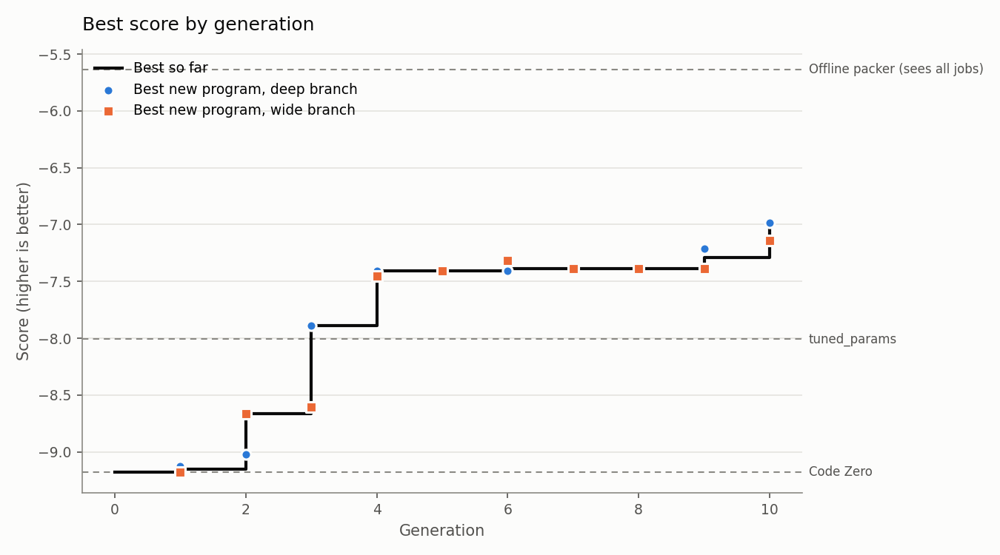

# Run report: 20261012-134507-full

- Engine: **features**, mode **full**, schedule parallel, 10 generations after Code Zero
- Models: deepseek-ai/DeepSeek-V4.1-Flash
- LLM calls: 99 (222,755 tokens in, 38,143 out)
- Best train score: **-6.986** (Code Zero -9.181)

## Held-out check

Scored on the evaluator's `test` split: new instances, plus families the search never saw (lognormal, wide).

| Program | Train score | Test score | Test excess % on lognormal | Test excess % on wide |
|---|---|---|---|---|
| Evolved best (p0080, deep) | -6.986 | -6.703 | 4.58 | 5.61 |
| Code Zero | -9.181 | -8.909 | 10.31 | 5.48 |
| Baseline: alphaevolve_borg | -12.652 | -11.966 | 9.16 | 9.65 |
| Baseline: best_fit | -8.774 | -8.772 | 10.14 | 5.22 |
| Baseline: dot_product | -8.392 | -7.960 | 7.04 | 5.35 |
| Baseline: tuned_params | -8.009 | -7.390 | 6.55 | 4.56 |
| *Reference: offline best-fit decreasing (sees every job in advance)* | -5.634 | -4.905 | 3.61 | 1.43 |

**Progress to optimal** (0% = Code Zero, 100% = the optimal packing, `helix/bounds.py`): **25.1%** on train, **25.6%** on the held-out test split. Extra bins per 100 the optimum needs: 6.49 on train, 6.39 on test.

The score counts bins above a lower bound that ignores job shapes, so 0 can't be reached. As a practical yardstick, an offline packer that sees every job before placing any scores -5.634 on train. The evolved program has closed **61.9%** of the gap between Code Zero and that packer on train, and **55.1%** on the held-out test split (`python -m helix.reference`).

## Where the improvements came from

| Generation | Branch | Program | Score | Gain | What it did |
|---|---|---|---|---|---|
| 1 | deep | p0002 | -9.154 | +0.028 | added f0008 tight_fit_small_jobs; validation -9.094 |
| 2 | wide | p0011 | -8.662 | +0.492 | added f0010 tight_fit_small_jobs_scarce_gated; validation -8.644 |
| 3 | deep | p0020 | -7.891 | +0.771 | added f0021 same_resource_pairing; validation -7.748 |
| 4 | deep | p0029 | -7.405 | +0.487 | added f0030 two_large_same_resource_fit; validation -7.671 |
| 6 | wide | p0046 | -7.391 | +0.014 | added f0042 heavy_light_residual_asymmetry; validation -7.622 |
| 9 | deep | p0071 | -7.290 | +0.100 | added f0071 avoid_stranding_medium_pair; validation -7.389 |
| 10 | deep | p0080 | -6.986 | +0.304 | added f0077 large_pair_same_axis_completion, f0074 tight_fit_small_jobs_tighter_side_gated; validation -7.008 |

## Features by branch

Each feature is tried against the same refit without it; *validation gain* is the difference in score on validation instances the fitting never sees, which decides what is kept.

| Branch | Written | Invalid | Tried | Kept | Retired later | Best validation gain |
|---|---|---|---|---|---|---|
| deep | 40 | 1 | 39 | 5 | 0 | +0.896 |
| wide | 40 | 6 | 34 | 3 | 1 | +0.450 |

## The final policy

A weighted sum of 7 features with 7 fitted weights (validation score -7.008). *Importance* is how much the validation score drops when the feature is switched off.

| Feature | Name | Branch | Made in generation | Weights | Importance | What it measures |
|---|---|---|---|---|---|---|
| f0008 | tight_fit_small_jobs | deep | 1 | 1 | 15.695 | For each bin, the tightness of fit for the arriving item relative to the bin's remaining space: (item[0]/max(bins[:,0],1) + item[1]/max(bins[:,1],1))  |
| f0010 | tight_fit_small_jobs_scarce_gated | wide | 2 | 1 | 0.700 | Tightness of fit for small jobs, measured on the scarcer resource only and gated on a nearly-full bin. |
| f0021 | same_resource_pairing | deep | 3 | 1 | 6.032 | For each bin, residual r = bins - item (clip at 0). Let hi = argmax(item/capacity). Feature = (r[hi] / capacity[hi]) - (r[1-hi] / capacity[1-hi]): pos |
| f0030 | two_large_same_resource_fit | deep | 4 | 1 | 0.352 | Active only when max(item/capacity) >= 0.4. r = bins - item (clip at 0). hi = argmax(item/capacity). Feature = min(r[hi]/capacity[hi], 1.0) * (item[hi |
| f0071 | avoid_stranding_medium_pair | deep | 9 | 1 | 0.560 | Active only when 0.2 <= max(item/capacity) < 0.4. r = clip(bins - item, 0); a = r[:,0]/capacity[0], b = r[:,1]/capacity[1]. Feature = -( (a < 0.05) &  |
| f0077 | large_pair_same_axis_completion | deep | 10 | 1 | 0.217 | Active only when max(item/capacity) >= 0.4. hi = argmax(item/capacity); lo = 1-hi. r = clip(bins - item, 0). Feature = min(r[:,hi]/(0.4*capacity[hi]), |
| f0074 | tight_fit_small_jobs_tighter_side_gated | wide | 10 | 1 | 0.155 | Tight fit of a small job, but only on the resource where the bin is nearly full: gate on the tighter residual side. |

## Research log

Verdicts: 30 flat, 5 supported, 3 refuted, 1 redundant, 1 invalid

Supported hypotheses, largest gain first:

| Hypothesis | Base | Gain | Claim | Change | Families that moved most (excess %) |
|---|---|---|---|---|---|
| h0009 | p0011 | +0.896 | In large the champion makes 306 two-job bins (LM+ML x48, LL+LM x45) while the optimum makes 236 three-job bins and 73 2LL bins. The champion | For each bin, residual r = bins - item (clip at 0). Let hi = argmax(item/capacity). Feature = (r[hi] / capacity[hi]) - (r[1-hi] / capacity[1 |  |
| h0037 | p0071 | +0.225 | In large the champion makes 274 two-job bins (LM+ML x64, LL+ML x46) and strands 14 bins, while the optimum makes 236 three-job bins dominate | Active only when max(item/capacity) >= 0.4. hi = argmax(item/capacity); lo = 1-hi. r = clip(bins - item, 0). Feature = min(r[:,hi]/(0.4*capa |  |
| h0035 | p0046 | +0.198 | In large the champion strands 23 bins (12%/10% room) vs optimum 2, and in uniform 16 vs 0. The champion's features measure fit of the arrivi | Active only when 0.2 <= max(item/capacity) < 0.4. r = clip(bins - item, 0); a = r[:,0]/capacity[0], b = r[:,1]/capacity[1]. Feature = -( (a  |  |
| h0014 | p0020 | +0.077 | In large the optimum's top bin is 2LL x73 and bimodal's is 2LL x44 — two jobs heavy in the same resource sharing a bin — while the champion  | Active only when max(item/capacity) >= 0.4. r = bins - item (clip at 0). hi = argmax(item/capacity). Feature = min(r[hi]/capacity[hi], 1.0)  |  |
| h0004 | p0001 | +0.074 | In small the champion uses 112 bins vs 111 optimum but its bins hold 8.93 jobs vs 9.01, and it has more 9SS/10SS bins while the optimum has  | For each bin, the tightness of fit for the arriving item relative to the bin's remaining space: (item[0]/max(bins[:,0],1) + item[1]/max(bins |  |

