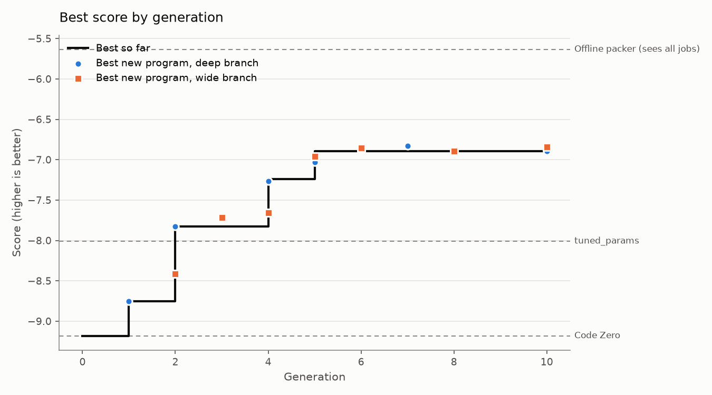

# Run report: 20261014-042737-full

- Engine: **features**, mode **full**, schedule parallel, 10 generations after Code Zero
- Models: deepseek-ai/DeepSeek-V4.1-Flash
- LLM calls: 92 (231,203 tokens in, 33,393 out)
- Best train score: **-7.034** (Code Zero -9.181)

## Held-out check

Scored on the evaluator's `test` split: new instances, plus families the search never saw (lognormal, wide).

| Program | Train score | Test score | Test excess % on lognormal | Test excess % on wide |
|---|---|---|---|---|
| Evolved best (p0037, wide) | -7.034 | -6.686 | 4.42 | 4.69 |
| Code Zero | -9.181 | -8.909 | 10.31 | 5.48 |
| Baseline: alphaevolve_borg | -12.652 | -11.966 | 9.16 | 9.65 |
| Baseline: best_fit | -8.774 | -8.772 | 10.14 | 5.22 |
| Baseline: dot_product | -8.370 | -7.960 | 7.04 | 5.35 |
| Baseline: tuned_params | -8.009 | -7.390 | 6.55 | 4.56 |
| *Reference: offline best-fit decreasing (sees every job in advance)* | -5.634 | -4.905 | 3.61 | 1.43 |

**Progress to optimal** (0% = Code Zero, 100% = the optimal packing, `helix/bounds.py`): **24.6%** on train, **25.8%** on the held-out test split. Extra bins per 100 the optimum needs: 6.53 on train, 6.37 on test.

The score counts bins above a lower bound that ignores job shapes, so 0 can't be reached. As a practical yardstick, an offline packer that sees every job before placing any scores -5.634 on train. The evolved program has closed **60.5%** of the gap between Code Zero and that packer on train, and **55.5%** on the held-out test split (`python -m helix.reference`).

## Where the improvements came from

| Generation | Branch | Program | Score | Gain | What it did |
|---|---|---|---|---|---|
| 1 | deep | p0002 | -8.913 | +0.268 | added f0008 fullness_vs_item_size; validation -8.893 |
| 2 | deep | p0011 | -7.830 | +1.083 | added f0016 dual_slack_balance, f0010 gated_fullness_balance_match, f0015 empty_bin_penalty_conditional; validation -8.161 |
| 4 | deep | p0028 | -7.264 | +0.566 | added f0029 post_placement_imbalance_gate, f0025 per_resource_squared_fullness_gap; validation -7.492 |
| 5 | wide | p0037 | -7.034 | +0.230 | added f0034 fullness_match_directional_gate, f0036 dominant_resource_alignment; validation -7.134 |

## Features by branch

Each feature is tried against the same refit without it; *validation gain* is the difference in score on validation instances the fitting never sees, which decides what is kept.

| Branch | Written | Invalid | Tried | Kept | Retired later | Best validation gain |
|---|---|---|---|---|---|---|
| deep | 40 | 0 | 13 | 4 | 0 | +0.598 |
| wide | 40 | 1 | 13 | 4 | 0 | +0.237 |

## The final policy

A weighted sum of 8 features with 8 fitted weights (validation score -7.134). *Importance* is how much the validation score drops when the feature is switched off.

| Feature | Name | Branch | Made in generation | Weights | Importance | What it measures |
|---|---|---|---|---|---|---|
| f0008 | fullness_vs_item_size | deep | 1 | 1 | 9.386 | s = (item[0]+item[1])/capacity; rem = (bins[:,0]+bins[:,1])/capacity; return -abs(rem - s) (peaks for bins whose total residual just matches the job;  |
| f0016 | dual_slack_balance | deep | 2 | 1 | 0.191 | r = (bins - item)/capacity; return np.minimum(r[:,0], r[:,1]) - 0.5*np.abs(r[:,0]-r[:,1]) (peaks for bins that stay balanced and non-tight; empty bin  |
| f0010 | gated_fullness_balance_match | wide | 2 | 1 | 0.117 | Like fullness_vs_item_size but only counts bins whose tighter-resource residual is >= the job's need there; peaks when the slack after placing matches |
| f0015 | empty_bin_penalty_conditional | deep | 2 | 1 | 0.090 | r = (bins - item)/capacity; fit = np.min(r, axis=1); best_existing = np.max(fit[:-1]) if len(bins)>1 else -1; return np.where(fit < 0.05, -1.0, 0.0) * |
| f0029 | post_placement_imbalance_gate | deep | 4 | 1 | 1.614 | r = (bins - item)/capacity; lo = np.minimum(r[:,0], r[:,1]); hi = np.maximum(r[:,0], r[:,1]); return np.where(lo < 0.15, hi - lo, 0.0) # only bins tha |
| f0025 | per_resource_squared_fullness_gap | wide | 4 | 1 | 0.016 | Fullness match measured per-resource: negative sum of squared per-resource residual gaps, sharpened by a match gate. |
| f0034 | fullness_match_directional_gate | wide | 5 | 1 | 0.112 | Fullness match with a directional term: reward bins where the job's larger resource demand lands in the bin's larger free resource. |
| f0036 | dominant_resource_alignment | wide | 5 | 1 | 0.170 | Fraction of the job's demand that would be 'wasted' by pairing its dominant resource with the bin's dominant slack, weighted by how tight the bin's ot |

## Research log

Verdicts: 33 refuted, 4 supported, 2 flat, 1 redundant

Supported hypotheses, largest gain first:

| Hypothesis | Base | Gain | Claim | Change | Families that moved most (excess %) |
|---|---|---|---|---|---|
| h0013 | p0011 | +0.598 | In large and anticorr the champion strands 54/71 bins (optimum 2/0) and leaves 14% room in both resources, because every kept feature reward | r = (bins - item)/capacity; lo = np.minimum(r[:,0], r[:,1]); hi = np.maximum(r[:,0], r[:,1]); return np.where(lo < 0.15, hi - lo, 0.0) # onl |  |
| h0008 | p0002 | +0.585 | Optimum in anticorr packs LS+MS+SL+SM x75 (four mixed-shape jobs) while champion stops at 3-job bins and strands 111 bins. The champion neve | r = (bins - item)/capacity; return np.minimum(r[:,0], r[:,1]) - 0.5*np.abs(r[:,0]-r[:,1]) (peaks for bins that stay balanced and non-tight;  |  |
| h0007 | p0002 | +0.159 | Champion opens new bins in large/anticorr even when a nearly-full bin could absorb the job, because f0008 gives the empty bin a near-perfect | r = (bins - item)/capacity; fit = np.min(r, axis=1); best_existing = np.max(fit[:-1]) if len(bins)>1 else -1; return np.where(fit < 0.05, -1 |  |
| h0004 | p0001 | +0.145 | Large optimum packs 2LL x73 (two big jobs together) and champion does not; champion puts big jobs with small ones leaving slack. A bin whose | s = (item[0]+item[1])/capacity; rem = (bins[:,0]+bins[:,1])/capacity; return -abs(rem - s) (peaks for bins whose total residual just matches |  |

