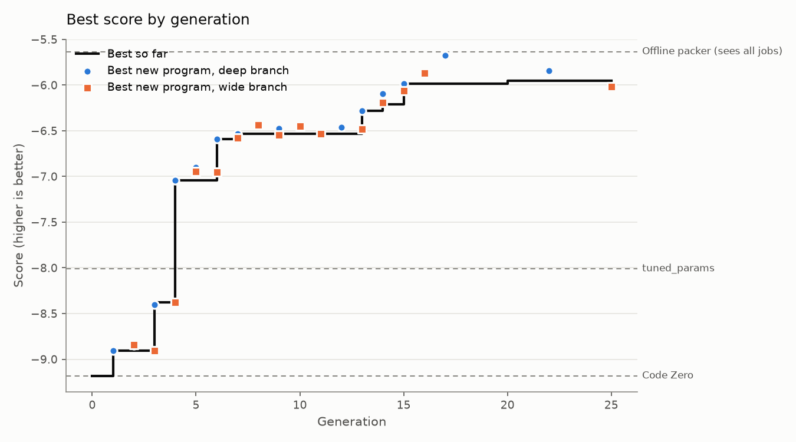

# Run report: 20261014-051542-full

- Engine: **features**, mode **full**, schedule parallel, 25 generations after Code Zero
- Models: deepseek-ai/DeepSeek-V4.1-Flash
- LLM calls: 238 (662,134 tokens in, 94,056 out)
- Best train score: **-6.156** (Code Zero -9.181)

## Held-out check

Scored on the evaluator's `test` split: new instances, plus families the search never saw (lognormal, wide).

| Program | Train score | Test score | Test excess % on lognormal | Test excess % on wide |
|---|---|---|---|---|
| Evolved best (p0121, deep) | -6.156 | -6.001 | 3.44 | 5.74 |
| Code Zero | -9.181 | -8.909 | 10.31 | 5.48 |
| Baseline: alphaevolve_borg | -12.652 | -11.966 | 9.16 | 9.65 |
| Baseline: best_fit | -8.774 | -8.772 | 10.14 | 5.22 |
| Baseline: dot_product | -8.370 | -7.960 | 7.04 | 5.35 |
| Baseline: tuned_params | -8.009 | -7.390 | 6.55 | 4.56 |
| *Reference: offline best-fit decreasing (sees every job in advance)* | -5.634 | -4.905 | 3.61 | 1.43 |

**Progress to optimal** (0% = Code Zero, 100% = the optimal packing, `helix/bounds.py`): **34.6%** on train, **33.7%** on the held-out test split. Extra bins per 100 the optimum needs: 5.66 on train, 5.69 on test.

The score counts bins above a lower bound that ignores job shapes, so 0 can't be reached. As a practical yardstick, an offline packer that sees every job before placing any scores -5.634 on train. The evolved program has closed **85.3%** of the gap between Code Zero and that packer on train, and **72.6%** on the held-out test split (`python -m helix.reference`).

## Where the improvements came from

| Generation | Branch | Program | Score | Gain | What it did |
|---|---|---|---|---|---|
| 1 | deep | p0002 | -8.904 | +0.277 | added f0008 small_job_slack_gain; validation -8.960 |
| 3 | deep | p0019 | -8.406 | +0.498 | added f0024 bimodal_small_stack_slack; validation -8.547 |
| 4 | deep | p0028 | -7.043 | +1.363 | added f0031 stranded_avoidance_ratio, f0032 bimodal_big_then_small_reserve; validation -7.438 |
| 6 | deep | p0045 | -6.601 | +0.442 | added f0046 tight_axis_second_fit; validation -6.985 |
| 13 | deep | p0103 | -6.298 | +0.303 | added f0101 large_axis_saturation_gap; validation -6.742 |
| 14 | wide | p0112 | -6.212 | +0.086 | added f0107 lopsided_strand_penalty, f0112 large_item_bin_axis_fit_ratio; validation -6.631 |
| 15 | deep | p0121 | -6.156 | +0.057 | added f0119 two_large_pair_priority_bimodal; validation -6.508 |

## Features by branch

Each feature is tried against the same refit without it; *validation gain* is the difference in score on validation instances the fitting never sees, which decides what is kept.

| Branch | Written | Invalid | Tried | Kept | Retired later | Best validation gain |
|---|---|---|---|---|---|---|
| deep | 106 | 0 | 30 | 9 | 0 | +0.952 |
| wide | 103 | 0 | 24 | 1 | 0 | +0.067 |

## The final policy

A weighted sum of 10 features with 10 fitted weights (validation score -6.399). *Importance* is how much the validation score drops when the feature is switched off.

| Feature | Name | Branch | Made in generation | Weights | Importance | What it measures |
|---|---|---|---|---|---|---|
| f0008 | small_job_slack_gain | deep | 1 | 1 | 0.311 | For each bin: before = min(bins[:,0],bins[:,1])/capacity[0]; after = min((bins-item)[:,0],(bins-item)[:,1])/capacity[0] (clip at 0); item_min = min(it |
| f0024 | bimodal_small_stack_slack | deep | 3 | 1 | 0.291 | item_small = (max(item)/capacity[0] <= 0.2); after = clip(bins - item, 0, None)/capacity; return item_small * (1 - abs(after[:,0] - after[:,1])) * (1  |
| f0031 | stranded_avoidance_ratio | deep | 4 | 1 | 0.100 | after = clip(bins - item, 0, None)/capacity; tight = minimum(after[:,0], after[:,1]); loose = maximum(after[:,0], after[:,1]); return -(loose - tight) |
| f0032 | bimodal_big_then_small_reserve | deep | 4 | 1 | 0.124 | item_big = (min(item)/capacity[0] >= 0.3); after = clip(bins - item, 0, None)/capacity; return item_big * (1 - max(after[:,0], after[:,1])) * (1 - abs |
| f0046 | tight_axis_second_fit | deep | 6 | 1 | 3.608 | after = clip(bins - item, 0, None)/capacity; item_t = min(item)/capacity[0]; item_l = max(item)/capacity[0]; bin_t = min(bins[:,0],bins[:,1])/capacity |
| f0053 | tight_axis_after_fit_count | deep | 7 | 1 | 0.222 | after = clip(bins - item, 0, None)/capacity[0]; item_t = min(item)/capacity[0]; tight = minimum(after[:,0], after[:,1]); frac = tight/(item_t + 1e-6); |
| f0101 | large_axis_saturation_gap | deep | 13 | 1 | 3.024 | after = clip(bins - item, 0, None)/capacity; item_t = min(item)/capacity[0]; item_l = max(item)/capacity[0]; room_t = minimum(after[:,0], after[:,1]); |
| f0107 | lopsided_strand_penalty | wide | 14 | 1 | 0.063 | For jobs that are lopsided (one axis much bigger), penalise bins that leave the small axis stranded while the big axis stays roomy; scale by how stran |
| f0112 | large_item_bin_axis_fit_ratio | deep | 14 | 1 | 0.033 | after = clip(bins - item, 0, None)/capacity; item_t = min(item)/capacity[0]; item_l = max(item)/capacity[0]; item_big = (item_t >= 0.3); before = bins |
| f0119 | two_large_pair_priority_bimodal | deep | 15 | 1 | 0.168 | after = clip(bins - item, 0, None)/capacity; item_t = min(item)/capacity[0]; item_l = max(item)/capacity[0]; item_big = (item_t >= 0.3); room_t = mini |

## Research log

Verdicts: 83 refuted, 11 flat, 9 supported, 3 redundant

Supported hypotheses, largest gain first:

| Hypothesis | Base | Gain | Claim | Change | Families that moved most (excess %) |
|---|---|---|---|---|---|
| h0015 | p0019 | +0.952 | Stranded bins are the single clearest signal: large 50 vs 2, anticorr 91 vs 0, bimodal 45 vs 3, uniform 20 vs 0. A bin becomes stranded when | after = clip(bins - item, 0, None)/capacity; tight = minimum(after[:,0], after[:,1]); loose = maximum(after[:,0], after[:,1]); return -(loos |  |
| h0022 | p0028 | +0.411 | The champion's dominant large bin is LM+ML (two medium jobs, one CPU-heavy one memory-heavy) and its dominant anticorr bin is LS+MS+SL; the  | after = clip(bins - item, 0, None)/capacity; item_t = min(item)/capacity[0]; item_l = max(item)/capacity[0]; bin_t = min(bins[:,0],bins[:,1] |  |
| h0012 | p0002 | +0.396 | In bimodal the optimum stacks many small jobs (4SS+LS+SL x13, 3SS+LS+SL x11) to fill residual slack left by big jobs, while the champion ope | item_small = (max(item)/capacity[0] <= 0.2); after = clip(bins - item, 0, None)/capacity; return item_small * (1 - abs(after[:,0] - after[:, |  |
| h0049 | p0054 | +0.147 | In large the champion averages 2.34 jobs/bin leaving CPU 13%/mem 11% room, while the optimum packs 2LL x73 and leaves 3%/0%. The champion pa | after = clip(bins - item, 0, None)/capacity; item_t = min(item)/capacity[0]; item_l = max(item)/capacity[0]; room_t = minimum(after[:,0], af |  |
| h0059 | p0112 | +0.123 | In bimodal the optimum's top bin is 2LL x44 while the champion only reaches 2LL x24 and instead scatters large jobs into LL+LS+SL x14 and LL | after = clip(bins - item, 0, None)/capacity; item_t = min(item)/capacity[0]; item_l = max(item)/capacity[0]; item_big = (item_t >= 0.3); roo |  |
| h0016 | p0019 | +0.098 | In bimodal the optimum's top bin is 2LL x44 (two jobs both large on both axes) while the champion's is 2LL x16 plus many LL+SL/LL+LS mixes.  | item_big = (min(item)/capacity[0] >= 0.3); after = clip(bins - item, 0, None)/capacity; return item_big * (1 - max(after[:,0], after[:,1]))  |  |
| h0025 | p0045 | +0.096 | In large the champion uses 429 bins vs 382 optimum, average 2.33 jobs/bin vs 2.62, and leaves CPU 13%/mem 11% room while the optimum leaves  | after = clip(bins - item, 0, None)/capacity[0]; item_t = min(item)/capacity[0]; tight = minimum(after[:,0], after[:,1]); frac = tight/(item_ |  |
| h0004 | p0001 | +0.078 | In small/bimodal/uniform the champion uses more bins than optimum (112 vs 111, 297 vs 280) and its common bins are less full (9SS x17 vs opt | For each bin: before = min(bins[:,0],bins[:,1])/capacity[0]; after = min((bins-item)[:,0],(bins-item)[:,1])/capacity[0] (clip at 0); item_mi |  |
| h0056 | p0103 | +0.045 | In large the champion averages 2.36 jobs/bin vs optimum 2.62 and leaves 12%/10% room, so it is opening bins it then cannot fill. Its large_a | after = clip(bins - item, 0, None)/capacity; item_t = min(item)/capacity[0]; item_l = max(item)/capacity[0]; item_big = (item_t >= 0.3); bef |  |

