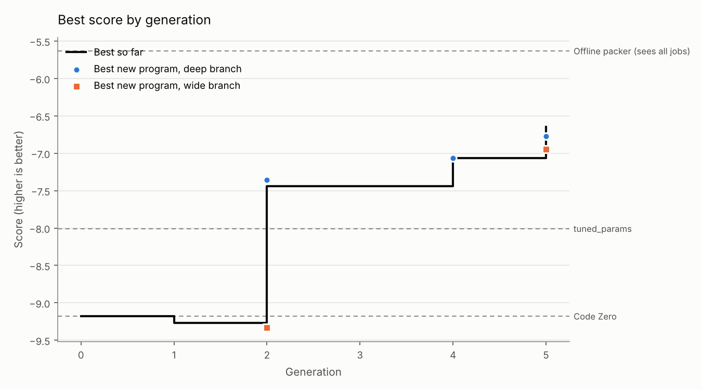

# Run report: 20261017-014858-full

- Engine: **features**, mode **full**, schedule parallel, 5 generations after Code Zero
- Models: deepseek-ai/DeepSeek-V4.1-Flash
- LLM calls: 46 (81,173 tokens in, 16,179 out)
- Best train score: **-6.774** (Code Zero -9.181)

## Held-out check

Scored on the evaluator's `test` split: new instances, plus families the search never saw (lognormal, wide).

| Program | Train score | Test score | Test excess % on lognormal | Test excess % on wide |
|---|---|---|---|---|
| Evolved best (p0036, deep) | -6.774 | -6.645 | 5.56 | 5.21 |
| Code Zero | -9.181 | -8.909 | 10.31 | 5.48 |
| Baseline: alphaevolve_borg | -12.652 | -11.966 | 9.16 | 9.65 |
| Baseline: best_fit | -8.774 | -8.772 | 10.14 | 5.22 |
| Baseline: dot_product | -8.423 | -7.993 | 7.04 | 5.35 |
| Baseline: tuned_params | -8.009 | -7.390 | 6.55 | 4.56 |
| *Reference: offline best-fit decreasing (sees every job in advance)* | -5.634 | -4.905 | 3.61 | 1.43 |

**Progress to optimal** (0% = Code Zero, 100% = the optimal packing, `helix/bounds.py`): **27.5%** on train, **26.2%** on the held-out test split. Extra bins per 100 the optimum needs: 6.28 on train, 6.33 on test.

The score counts bins above a lower bound that ignores job shapes, so 0 can't be reached. As a practical yardstick, an offline packer that sees every job before placing any scores -5.634 on train. The evolved program has closed **67.8%** of the gap between Code Zero and that packer on train, and **56.5%** on the held-out test split (`python -m helix.reference`).

## Where the improvements came from

| Generation | Branch | Program | Score | Gain | What it did |
|---|---|---|---|---|---|
| 2 | deep | p0010 | -7.356 | +1.826 | added f0013 class_match_residual; validation -7.525 |
| 4 | deep | p0027 | -7.125 | +0.231 | added f0031 closing_bin_penalty; validation -7.343 |
| 5 | deep | p0036 | -6.774 | +0.350 | added f0040 big_with_big_room_penalty, f0037 bimodal_small_slot_for_large; validation -7.003 |

## Features by branch

Each feature is tried against the same refit without it; *validation gain* is the difference in score on validation instances the fitting never sees, which decides what is kept.

| Branch | Written | Invalid | Tried | Kept | Retired later | Best validation gain |
|---|---|---|---|---|---|---|
| deep | 20 | 0 | 6 | 4 | 0 | +1.513 |
| wide | 20 | 0 | 4 | 0 | 0 | +0.126 |

## The final policy

A weighted sum of 4 features with 4 fitted weights (validation score -7.003). *Importance* is how much the validation score drops when the feature is switched off.

| Feature | Name | Branch | Made in generation | Weights | Importance | What it measures |
|---|---|---|---|---|---|---|
| f0013 | class_match_residual | deep | 2 | 1 | 1.627 | r = (bins - item)/capacity (post-placement residual). Define item class per resource: big = item/capacity > 0.4. For each bin, let m = min(r[:,0], r[: |
| f0031 | closing_bin_penalty | deep | 4 | 1 | 5.716 | r = (bins - item)/capacity. tight = min(r[:,0], r[:,1]); loose = max(r[:,0], r[:,1]). Return -(tight + loose)/2 for open bins (last row excluded), i.e |
| f0040 | big_with_big_room_penalty | deep | 5 | 1 | 0.700 | Active only when max(item)/capacity > 0.4. r = (bins - item)/capacity (post-placement, clipped at 0). Return min(r[:,0], r[:,1]) - max(r[:,0], r[:,1]) |
| f0037 | bimodal_small_slot_for_large | deep | 5 | 1 | 0.169 | Active only when max(item)/capacity > 0.4. r = (bins - item)/capacity. tight = min(r[:,0], r[:,1]). Return -tight * (tight > 0.2) + tight * (tight <=  |

## Research log

Verdicts: 14 refuted, 4 supported, 1 flat, 1 redundant

Supported hypotheses, largest gain first:

| Hypothesis | Base | Gain | Claim | Change | Families that moved most (excess %) |
|---|---|---|---|---|---|
| h0005 | p0001 | +1.513 | In large and anticorr the champion makes 2-job bins of same-class pairs (LM+ML x49, LL+LM x44) and strands 55/104 bins, while optimum makes  | r = (bins - item)/capacity (post-placement residual). Define item class per resource: big = item/capacity > 0.4. For each bin, let m = min(r |  |
| h0015 | p0010 | +0.183 | In large the champion uses 432 bins with 2.31 jobs/bin and 12-14% room left in BOTH resources, while optimum reaches 2.62 jobs/bin with only | r = (bins - item)/capacity. tight = min(r[:,0], r[:,1]); loose = max(r[:,0], r[:,1]). Return -(tight + loose)/2 for open bins (last row excl |  |
| h0020 | p0027 | +0.161 | In large the champion makes LL+LM x42, LL+ML x40, LL+MM x36 — every large job is paired with a different-class partner, leaving 12-14% in bo | Active only when max(item)/capacity > 0.4. r = (bins - item)/capacity (post-placement, clipped at 0). Return min(r[:,0], r[:,1]) - max(r[:,0 |  |
| h0017 | p0027 | +0.070 | In bimodal the champion makes 2LL x13 vs optimum 2LL x44, and 3SS+LS+SL x10 vs optimum 4SS+LS+SL x13. When a large job arrives, the policy a | Active only when max(item)/capacity > 0.4. r = (bins - item)/capacity. tight = min(r[:,0], r[:,1]). Return -tight * (tight > 0.2) + tight *  |  |

